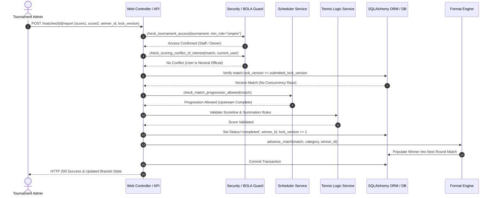
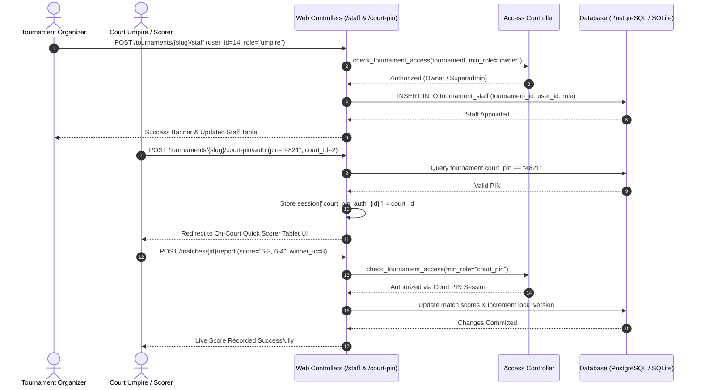

# TourneyPro — Technical & Software Architecture (ARCHITECTURE.md)

**Document Status:** Approved  
**Source of Truth:** Inherits from [`PRD.md`](file:///Users/rahilmehta24/VS_Code/Projects/TourneyPro/PRD.md) and [`DESIGN.md`](file:///Users/rahilmehta24/VS_Code/Projects/TourneyPro/DESIGN.md)  
**Architecture Version:** 2.1  
**Runtime:** Python 3.12.8 / Flask 3.1.3 / SQLAlchemy 2.0.51  
**Last Updated:** November 2026  

---

## 1. System Context & High-Level Architecture

TourneyPro follows a clean, modular monolith architecture with server-side rendered (SSR) web interfaces and a headless REST API layer sharing a unified domain and service foundation.

```
                              ┌───────────────────────────────────────────────┐
                              │            Clients / Presentation             │
                              │  - Web Browser (SSR Jinja2 + Vanilla CSS3)    │
                              │  - REST API Consumers (Mobile / External)     │
                              └──────────────────────┬────────────────────────┘
                                                     │ HTTP / HTTPS
                                                     ▼
                              ┌───────────────────────────────────────────────┐
                              │               Routing & Security              │
                              │  - WSGI Server (Gunicorn) / Vercel Serverless │
                              │  - CSRFProtect (Web) / JWT Bearer Auth (API)  │
                              │  - Flask-Compress (Brotli / Gzip)             │
                              └──────────────────────┬────────────────────────┘
                                                     │
                                                     ▼
                              ┌───────────────────────────────────────────────┐
                              │           Flask Application Factory           │
                              │                   create_app()                │
                              └──────────────────────┬────────────────────────┘
                                                     │
         ┌───────────────────┬───────────────────────┼────────────────────────┬───────────────────┐
         ▼                   ▼                       ▼                        ▼                   ▼
┌─────────────────┐ ┌─────────────────┐     ┌─────────────────┐      ┌─────────────────┐ ┌─────────────────┐
│  Tournament BP  │ │   Category BP   │     │    Player BP    │      │    Auth BP      │ │     API BP      │
│ (Setup/Courts)  │ │ (Brackets/Draw) │     │(Registry/Stats) │      │  (RBAC / BOLA)  │ │   (/api/v1/)    │
└────────┬────────┘ └────────┬────────┘     └────────┬────────┘      └────────┬────────┘ └────────┬────────┘
         │                   │                       │                        │                   │
         └───────────────────┴───────────────────────┼────────────────────────┴───────────────────┘
                                                     │
                                                     ▼
                              ┌───────────────────────────────────────────────┐
                              │                 Service Layer                 │
                              │  - Format Engine (Knockout, Group Stage, RR)  │
                              │  - Court Scheduler & Progression Engine       │
                              │  - Tennis Logic & Rubber Scorer               │
                              │  - Leaderboard & Statistics Calculator        │
                              │  - PDF Vector Export Generation Service       │
                              └──────────────────────┬────────────────────────┘
                                                     │
                                                     ▼
                              ┌───────────────────────────────────────────────┐
                              │           Domain & Persistence Layer          │
                              │  - SQLAlchemy 2.0 ORM Models                  │
                              │  - Marshmallow Schemas                        │
                              │  - Alembic Migrations & Schema Sync Engine    │
                              └──────────────────────┬────────────────────────┘
                                                     │
                           ┌─────────────────────────┴─────────────────────────┐
                           ▼                                                   ▼
              ┌─────────────────────────┐                         ┌─────────────────────────┐
              │ SQLite (Dev / Testing)  │                         │ PostgreSQL / Supabase   │
              │ (instance/tournaments.db)                         │ (Production / Staging)  │
              └─────────────────────────┘                         └─────────────────────────┘
```

---

## 2. Application Factory & Modular Blueprints

The application is initialized using the Application Factory Pattern in [`app/__init__.py`](file:///Users/rahilmehta24/VS_Code/Projects/TourneyPro/app/__init__.py) via `create_app(config_class=Config)`.

### 2.1 Blueprint Registry

| Blueprint | Controller Path | Responsibilities & Scope |
| :--- | :--- | :--- |
| `main_bp` | [`app/web/controllers/main.py`](file:///Users/rahilmehta24/VS_Code/Projects/TourneyPro/app/web/controllers/main.py) | Public landing page, search, and global index. |
| `tournament_bp` | [`app/web/controllers/tournament.py`](file:///Users/rahilmehta24/VS_Code/Projects/TourneyPro/app/web/controllers/tournament.py) | Tournament lifecycle, court configuration, staff appointment delegation (`/staff`), court PIN scoring (`/court-pin/score`), and Order of Play rendering. |
| `category_bp` | [`app/web/controllers/category.py`](file:///Users/rahilmehta24/VS_Code/Projects/TourneyPro/app/web/controllers/category.py) | Category lifecycle, draw generation, draw publication state machine (`/toggle-publish`), team drafting (Mode A/B), rubber scoring, and match progression. |
| `player_bp` | [`app/web/controllers/player.py`](file:///Users/rahilmehta24/VS_Code/Projects/TourneyPro/app/web/controllers/player.py) | Global player registry, player profiles, win-rate metrics, and career records. |
| `leaderboard_bp`| [`app/web/controllers/leaderboard.py`](file:///Users/rahilmehta24/VS_Code/Projects/TourneyPro/app/web/controllers/leaderboard.py)| Tournament podiums and overall global player leaderboards. |
| `academy_bp` | [`app/web/controllers/academy.py`](file:///Users/rahilmehta24/VS_Code/Projects/TourneyPro/app/web/controllers/academy.py) | Academy hubs, club rosters, member roles, and internal tournaments. |
| `auth_bp` | [`app/web/controllers/auth.py`](file:///Users/rahilmehta24/VS_Code/Projects/TourneyPro/app/web/controllers/auth.py) | Authentication (login/logout/register), hierarchical RBAC guards, BOLA decorators (`check_tournament_access`), and superadmin bootstrap. |
| `export_bp` | [`app/web/controllers/export.py`](file:///Users/rahilmehta24/VS_Code/Projects/TourneyPro/app/web/controllers/export.py) | High-performance PDF bracket/schedule downloads and Excel participant exports. |
| `api_bp` | [`app/api/__init__.py`](file:///Users/rahilmehta24/VS_Code/Projects/TourneyPro/app/api/__init__.py) | RESTful API (`/api/v1/`) with stateless JWT auth, exempt from CSRF. |

---

## 3. Service Layer Architecture

Business logic is strictly decoupled from web request handling into reusable domain services:

### 3.1 Format Engine (`app/services/format_engine/`)
An extensible strategy pattern managing tournament algorithms:
* `base.py`: Abstract base class defining `generate_bracket()`, `advance_match()`, and `get_standings()`.
* `single_elimination/`: Calculates power-of-2 geometry, balanced Bye distribution, and single-match knockout progression.
* `doubles_elimination/`: Manages pair entries and dual player score/point distribution.
* `round_robin/`: Exhaustive grid generation and cumulative game point aggregations.
* `group_stage/`: Multi-group team league logic, Mode A/B team drafting, 3-rubber fixture assembly, and Head-to-Head tiebreakers.

### 3.2 Court Scheduling Engine (`app/services/utils/scheduler.py`)
A comprehensive constraint satisfaction algorithm for tournament logistics:
* **Prerequisite Progression Checks:** Evaluates `check_match_progression_allowed(match)` ensuring no match is started before feeder matches complete.
* **Resource Conflict Resolution:** Enforces that a player is never scheduled simultaneously across courts or categories.
* **Rest Interval Compliance:** Guarantees `min_rest_minutes` (default 30 min) between successive matches for any participant.
* **Daily Schedule Distribution:** Balances matches across tournament days and operating hours (`court_operating_start` to `court_operating_end`).

### 3.3 Tennis & Scoring Logic (`app/services/tennis_logic.py`)
Handles parsing and validation of tennis scores:
* Validates set structures (Best of 1, 3, or 5).
* Handles tiebreak formatting (e.g. `7-6(5)`).
* Enforces summation rules for team rubbers ($G_1 + G_2 = 7$).
* Handles walkovers and mid-match retirements with automatic remainder game awards.

### 3.4 PDF Generation Engine (`app/services/pdf/`)
Generates vector PDF documents via `xhtml2pdf` and `reportlab`:
* `draw_adapter.py`: Adapts bracket hierarchies into printable vector layout models.
* `order_of_play_adapter.py`: Adapts court schedules into matrix layouts with time slots.
* `participants_adapter.py`: Adapts participant rosters and check-in tables.
* `pdf_generator.py`: Generates cached PDF binary streams with MD5 ETags and conditional HTTP 304 caching.

---

## 4. Dual Database & Storage Strategy

TourneyPro employs a dual database architecture configured in [`config.py`](file:///Users/rahilmehta24/VS_Code/Projects/TourneyPro/config.py):

### 4.1 SQLite (Local Development & Testing)
* Stored in [`instance/tournaments.db`](file:///Users/rahilmehta24/VS_Code/Projects/TourneyPro/instance/tournaments.db).
* Alembic migrations use `render_as_batch=True` to support table schema alterations without full table drop-and-recreate cycles.

### 4.2 PostgreSQL / Supabase (Cloud Staging & Production)
* Connected via `psycopg` (v3).
* Connection strings are sanitized to handle quotes and whitespace (`db_url.strip().strip("'\"")`).
* **PgBouncer Compatibility:** Set `pool_pre_ping=True` and `'prepare_threshold': None` in `SQLALCHEMY_ENGINE_OPTIONS` to support Supabase transaction poolers without prepared-statement name collisions.

### 4.3 Automated Schema Reconciliation Engine (`scripts/sync_db_schema.py`)
During production deployments (via GitHub Actions or CLI), this engine:
1. Inspects active database tables and column metadata via `sqlalchemy.inspect`.
2. Compares existing schemas against SQLAlchemy models in `app.domain.models`.
3. Issues idempotent `ALTER TABLE ... ADD COLUMN` statements for missing fields, preventing deployment crashes caused by unapplied migrations.

---

## 5. Security, RBAC & Access Control Architecture

### 5.1 Hierarchical Role-Based Access Control (RBAC)
TourneyPro enforces a multi-tier permission model separating platform governance, tournament ownership, operational delegation, and on-court officiating:

```
Platform Superadmin (superadmin)
  │ (Full platform bypass & user governance)
  ▼
Tournament Owner / Director (owner / tournament_admin)
  │ (Settings, court config, staff appointments, draw publishing)
  ▼
Tournament Desk / Operations Manager (desk)
  │ (Participant check-in, seed overrides, court scheduling, match scoring)
  ▼
Match Official / Chair Umpire (umpire)
  │ (Live scorekeeping, rubber completion on assigned courts)
  ▼
Court PIN Fast-Entry Mode (court_pin)
  │ (Device-level live scoring via 4-digit court PIN without user accounts)
  ▼
Team League Captain (captain)
  │ (Lineup submission within pre-tie cutoff window)
  ▼
Competitor / Spectator (spectator / user)
  │ (Public bracket viewing, roster inspection, PDF downloads for published draws)
```

### 5.2 Broken Object Level Authorization (BOLA/IDOR) Defense
To eliminate IDOR vulnerabilities across web controllers and the REST API, access is governed centrally via `check_tournament_access()`:

```python
def check_tournament_access(tournament, min_role="umpire", write_required=True):
    # 1. Superadmin bypass
    if current_user.is_authenticated and current_user.role == "superadmin":
        return True, "superadmin"

    # 2. Tournament Owner bypass
    if current_user.is_authenticated and tournament.user_id == current_user.id:
        return True, "owner"

    # 3. Court PIN tablet session check (for scoring endpoints)
    court_pin_auth = session.get(f"court_pin_auth_{tournament.id}")
    if min_role == "court_pin" and court_pin_auth:
        return True, "court_pin"

    # 4. Delegated Tournament Staff lookup
    if current_user.is_authenticated:
        staff_record = TournamentStaff.query.filter_by(
            tournament_id=tournament.id, user_id=current_user.id
        ).first()
        if staff_record:
            role_ranks = {"owner": 4, "tournament_admin": 4, "desk": 3, "umpire": 2}
            min_ranks = {"owner": 4, "tournament_admin": 4, "desk": 3, "umpire": 2, "court_pin": 1}
            if role_ranks.get(staff_record.role, 0) >= min_ranks.get(min_role, 0):
                return True, staff_record.role

    abort(403)
```

### 5.3 Anti-Conflict of Interest Scoring Guard
To ensure sporting integrity, active tournament competitors are strictly prevented from officiating or reporting scores for their own matches:

```python
def check_scoring_conflict_of_interest(match, current_user):
    # Superadmins, dedicated umpires, and non-participant staff are permitted
    # If the user is linked to Participant 1 or Participant 2 in the match:
    if match.participant1 and match.participant1.user_id == current_user.id:
        return False, "Conflict of interest: Cannot score your own match."
    if match.participant2 and match.participant2.user_id == current_user.id:
        return False, "Conflict of interest: Cannot score your own match."
    # In doubles: check partner player accounts
    # In team leagues: check team captain / team roster associations
    return True, None
```

### 5.4 Optimistic Concurrency Control (`lock_version`)
To prevent concurrent referee or desk updates from silently overwriting live scores, the `matches` table tracks an integer `lock_version` (default: 1):
1. Client requests include the known `lock_version` of the match being edited.
2. If `submitted_version != match.lock_version`, the transaction aborts with `HTTP 409 Conflict`.
3. Upon successful commit, `match.lock_version` increments by 1.

### 5.5 Draw Publication State Guard
Categories maintain a boolean `draw_published` state (default: `False`):
* **Draft Draw Mode (`draw_published = False`):** Only tournament organizers and desk staff can view bracket layouts, seed seeds, and test progression. Spectators, players, and public API consumers receive a clean draft notice (`"Draws for this event are being finalized"`).
* **Published Draw Mode (`draw_published = True`):** Brackets, seeding, and downloadable vector PDF draw sheets are visible platform-wide.

### 5.6 Team Fixture Lineup Submission Cutoff
Captains can set and modify their 3-rubber team lineups via `/categories/<id>/fixtures/<id>/lineup` exclusively within the allowed submission window:
* Lineups lock permanently once the match status transitions from `scheduled` to `in_progress` or when the scheduled tie start time has passed.
* Non-captains and unauthenticated users receive `HTTP 403 Forbidden`.

### 5.7 CSRF & API Token Isolation
* `CSRFProtect` is initialized globally across all server-rendered forms.
* The API blueprint (`/api/v1/`) is explicitly exempted via `csrf.exempt(api_bp)`, relying exclusively on stateless JWT Bearer tokens in the `Authorization` header.

---

## 6. End-to-End Sequence Diagrams

### 6.1 Match Score Reporting & Progression Flow



### 6.2 Delegated Staff Appointment & Court PIN Officiating Flow



---

## 7. Deployment & Infrastructure Architecture

* **Container / Standard Server:** Run via `gunicorn run:app -w 4 -b 0.0.0.0:5000`.
* **Serverless Hosting (Vercel):** Configured via [`vercel.json`](file:///Users/rahilmehta24/VS_Code/Projects/TourneyPro/vercel.json):
  ```json
  {
    "builds": [{ "src": "run.py", "use": "@vercel/python" }],
    "routes": [{ "src": "/(.*)", "dest": "run.py" }]
  }
  ```
  Cold starts are optimized by skipping schema checks when `os.environ.get('VERCEL')` is detected.

---

## 8. Presentation & Mobile Web App Architecture

The presentation layer combines lightweight server-side rendering (Jinja2) with hardware-accelerated client-side gestures, delivering an app-like mobile experience without frontend framework overhead:

### 8.1 Viewport, Safe Areas & Auto-Zoom Prevention
* **Safe-Area Inset Management:** Uses `viewport-fit=cover` in `base.html` combined with CSS `env(safe-area-inset-bottom)` to accommodate iPhone home indicator notches and Android system gesture pills.
* **iOS Safari Auto-Zoom Prevention:** Form inputs (`input`, `select`, `textarea`) enforce `font-size: 16px !important;` on screens `≤ 768px`, eliminating automatic viewport zoom distortion on field focus.
* **Fluid Grid Blowout Safeguards:** Replaces rigid fixed-width grids with auto-collapsing CSS `minmax(min(100%, 280px), 1fr)` patterns, preventing horizontal page wobble.

### 8.2 Knockout Bracket Touch Navigation & SVG Coordinates
* **Touch Event Gesture Engine:** `category/view.html` binds `touchstart`, `touchmove`, and `touchend` listeners to the bracket viewport for momentum panning across large draw trees.
* **SVG Coordinate Preservation:** Bracket rounds remain horizontally organized (`display: flex; flex-direction: row;`) on all viewports, guaranteeing dynamic Bézier curve connectors calculate exact coordinates without displacement.
* **Round Jump Tabs:** Dedicated swipeable pill navigation (`Round of 16` → `Quarterfinals` → `Semifinals` → `Finals`) smoothly scrolls the viewport to target rounds.

### 8.3 Mobile Bottom Sheet & Intent Architecture
* **Bottom Sheet Modals:** Modals adapt to app-like bottom sheets on `≤ 640px` with dynamic viewport units (`max-height: 90dvh;`), grab handles, and sticky action buttons.
* **Deep-Linked UPI Intents:** Registration dynamically generates `upi://pay?pa=...` URIs on mobile devices, enabling 1-tap checkout into installed payment apps (GPay, PhonePe, Paytm).

