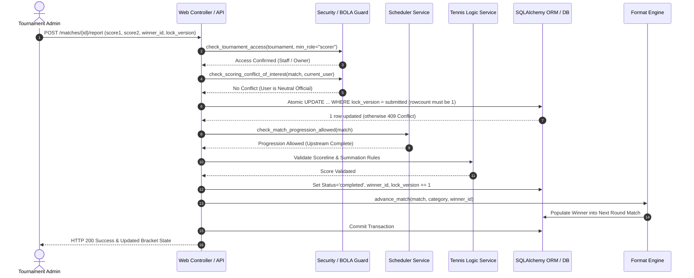
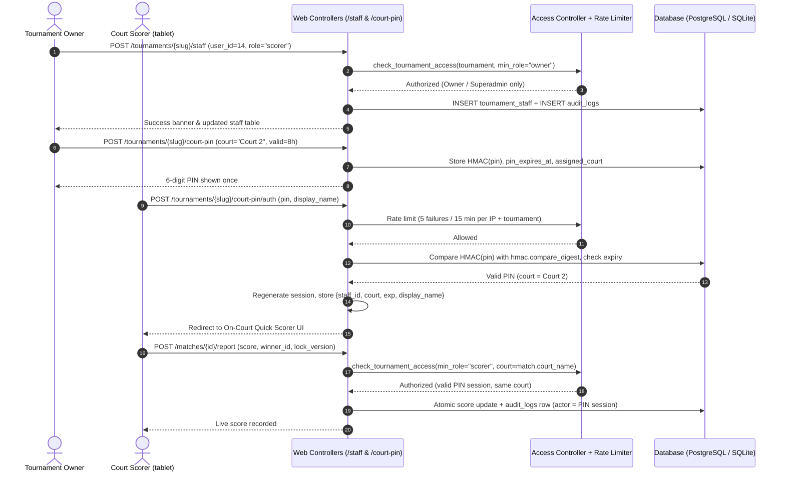

# The Baseline Society — Technical & Software Architecture (ARCHITECTURE.md)

**Document Status:** Approved  
**Source of Truth:** Inherits from [`PRD.md`](PRD.md) and [`DESIGN.md`](DESIGN.md)  
**Architecture Version:** 2.2 (security-hardened)  
**Runtime:** Python 3.12.8 / Flask 3.1.3 / SQLAlchemy 2.0.51  
**Last Updated:** November 2026  

---

## 1. System Context & High-Level Architecture

The Baseline Society follows a clean, modular monolith architecture with server-side rendered (SSR) web interfaces and a headless REST API layer sharing a unified domain and service foundation.

```
                              ┌───────────────────────────────────────────────┐
                              │            Clients / Presentation             │
                              │  - Web Browser (SSR Jinja2 + Vanilla CSS3)    │
                              │  - REST API Consumers (Mobile / External)     │
                              └──────────────────────┬────────────────────────┘
                                                     │ HTTP / HTTPS
                                                     ▼
                              ┌───────────────────────────────────────────────┐
                              │               Routing & Security              │
                              │  - WSGI Server (Gunicorn) / Vercel Serverless │
                              │  - CSRFProtect (Web) / JWT Bearer Auth (API)  │
                              │  - Flask-Compress (Brotli / Gzip)             │
                              └──────────────────────┬────────────────────────┘
                                                     │
                                                     ▼
                              ┌───────────────────────────────────────────────┐
                              │           Flask Application Factory           │
                              │                   create_app()                │
                              └──────────────────────┬────────────────────────┘
                                                     │
         ┌───────────────────┬───────────────────────┼────────────────────────┬───────────────────┐
         ▼                   ▼                       ▼                        ▼                   ▼
┌─────────────────┐ ┌─────────────────┐     ┌─────────────────┐      ┌─────────────────┐ ┌─────────────────┐
│  Tournament BP  │ │   Category BP   │     │    Player BP    │      │    Auth BP      │ │     API BP      │
│ (Setup/Courts)  │ │ (Brackets/Draw) │     │(Registry/Stats) │      │  (RBAC / BOLA)  │ │   (/api/v1/)    │
└────────┬────────┘ └────────┬────────┘     └────────┬────────┘      └────────┬────────┘ └────────┬────────┘
         │                   │                       │                        │                   │
         └───────────────────┴───────────────────────┼────────────────────────┴───────────────────┘
                                                     │
                                                     ▼
                              ┌───────────────────────────────────────────────┐
                              │                 Service Layer                 │
                              │  - Format Engine (Knockout, Group Stage, RR)  │
                              │  - Court Scheduler & Progression Engine       │
                              │  - Tennis Logic & Rubber Scorer               │
                              │  - Leaderboard & Statistics Calculator        │
                              │  - PDF Vector Export Generation Service       │
                              └──────────────────────┬────────────────────────┘
                                                     │
                                                     ▼
                              ┌───────────────────────────────────────────────┐
                              │           Domain & Persistence Layer          │
                              │  - SQLAlchemy 2.0 ORM Models                  │
                              │  - Marshmallow Schemas                        │
                              │  - Alembic Migrations & Schema Sync Engine    │
                              └──────────────────────┬────────────────────────┘
                                                     │
                           ┌─────────────────────────┴─────────────────────────┐
                           ▼                                                   ▼
              ┌─────────────────────────┐                         ┌─────────────────────────┐
              │ SQLite (Dev / Testing)  │                         │ PostgreSQL / Supabase   │
              │ (instance/tournaments.db)                         │ (Production / Staging)  │
              └─────────────────────────┘                         └─────────────────────────┘
```

---

## 2. Application Factory & Modular Blueprints

The application is initialized using the Application Factory Pattern in [`app/__init__.py`](app/__init__.py) via `create_app(config_class=Config)`.

### 2.1 Blueprint Registry

| Blueprint | Controller Path | Responsibilities & Scope |
| :--- | :--- | :--- |
| `main_bp` | [`app/web/controllers/main.py`](app/web/controllers/main.py) | Public landing page, search, and global index. |
| `tournament_bp` | [`app/web/controllers/tournament.py`](app/web/controllers/tournament.py) | Tournament lifecycle, court configuration, staff appointment delegation (`/staff`), Court PIN scoring (`/court-pin`), and Order of Play rendering. |
| `category_bp` | [`app/web/controllers/category.py`](app/web/controllers/category.py) | Category lifecycle, draw generation, draw publication state machine (`/toggle-publish`), team drafting (Mode A/B), rubber scoring, and match progression. |
| `player_bp` | [`app/web/controllers/player.py`](app/web/controllers/player.py) | Global player registry, player profiles, win-rate metrics, and career records. |
| `leaderboard_bp`| [`app/web/controllers/leaderboard.py`](app/web/controllers/leaderboard.py)| Tournament podiums and overall global player leaderboards. |
| `academy_bp` | [`app/web/controllers/academy.py`](app/web/controllers/academy.py) | Academy hubs, club rosters, member roles, and internal tournaments. |
| `auth_bp` | [`app/web/controllers/auth.py`](app/web/controllers/auth.py) | Authentication (login/logout/register), hierarchical RBAC guards, BOLA decorators (`check_tournament_access`), and superadmin bootstrap. |
| `export_bp` | [`app/web/controllers/export.py`](app/web/controllers/export.py) | High-performance PDF bracket/schedule downloads and Excel participant exports. |
| `api_bp` | [`app/api/__init__.py`](app/api/__init__.py) | RESTful API (`/api/v1/`) with stateless JWT auth, exempt from CSRF. |

---

## 3. Service Layer Architecture

Business logic is strictly decoupled from web request handling into reusable domain services:

### 3.1 Format Engine (`app/services/format_engine/`)
An extensible strategy pattern managing tournament algorithms:
* `base.py`: Abstract base class defining `generate_bracket()`, `advance_match()`, and `get_standings()`.
* `single_elimination/`: Calculates power-of-2 geometry, balanced Bye distribution, and single-match knockout progression.
* `doubles_elimination/`: Manages pair entries and dual player score/point distribution.
* `round_robin/`: Exhaustive grid generation and cumulative game point aggregations.
* `group_stage/`: Multi-group team league logic, Mode A/B team drafting, 3-rubber fixture assembly, and Head-to-Head tiebreakers.

### 3.2 Court Scheduling Engine (`app/services/utils/scheduler.py`)
A comprehensive constraint satisfaction algorithm for tournament logistics:
* **Prerequisite Progression Checks:** Evaluates `check_match_progression_allowed(match)` ensuring no match is started before feeder matches complete.
* **Resource Conflict Resolution:** Enforces that a player is never scheduled simultaneously across courts or categories.
* **Rest Interval Compliance:** Guarantees `min_rest_minutes` (default 30 min) between successive matches for any participant.
* **Daily Schedule Distribution:** Balances matches across tournament days and operating hours (`court_operating_start` to `court_operating_end`).

### 3.3 Tennis & Scoring Logic (`app/services/tennis_logic.py`)
Handles parsing and validation of tennis scores:
* Validates set structures (Best of 1, 3, or 5).
* Handles tiebreak formatting (e.g. `7-6(5)`).
* Enforces summation rules for team rubbers ($G_1 + G_2 = 7$).
* Handles walkovers and mid-match retirements with automatic remainder game awards.

### 3.4 PDF Generation Engine (`app/services/pdf/`)
Generates vector PDF documents via `xhtml2pdf` and `reportlab`:
* `draw_adapter.py`: Adapts bracket hierarchies into printable vector layout models.
* `order_of_play_adapter.py`: Adapts court schedules into matrix layouts with time slots.
* `participants_adapter.py`: Adapts participant rosters and check-in tables.
* `pdf_generator.py`: Generates PDF binary streams with conditional HTTP 304 caching. **The ETag must be computed from a cheap version stamp** (for example `max(match.lock_version, match.completed_at)` plus the `draw_published` flag), *before* rendering; hashing the finished PDF bytes cannot save CPU because the PDF would already have been rendered.
* **Safety rules:** all user-supplied text is HTML-escaped before entering a template; the `link_callback` resolves only local allow-listed assets (no `http(s)://` fetches, preventing SSRF); fonts are registered from local TTF files (web fonts cannot be loaded by `xhtml2pdf`).

---

## 4. Dual Database & Storage Strategy

The Baseline Society employs a dual database architecture configured in [`config.py`](config.py):

### 4.1 SQLite (Local Development & Testing)
* Stored in [`instance/tournaments.db`](instance/tournaments.db).
* Alembic migrations use `render_as_batch=True` to support table schema alterations without full table drop-and-recreate cycles.

### 4.2 PostgreSQL / Supabase (Cloud Staging & Production)
* Connected via `psycopg` (v3).
* Connection strings are sanitized to handle quotes and whitespace (`db_url.strip().strip("'\"")`).
* **PgBouncer Compatibility:** Set `pool_pre_ping=True` and `'prepare_threshold': None` in `SQLALCHEMY_ENGINE_OPTIONS` to support Supabase transaction poolers without prepared-statement name collisions.

### 4.3 Automated Schema Reconciliation Engine (`scripts/sync_db_schema.py`)
During production deployments (via GitHub Actions or CLI), this engine:
1. Inspects active database tables and column metadata via `sqlalchemy.inspect`.
2. Compares existing schemas against SQLAlchemy models in `app.domain.models`.
3. Issues idempotent `ALTER TABLE ... ADD COLUMN` statements for missing fields, preventing deployment crashes caused by unapplied migrations.

---

## 5. Security, RBAC & Access Control Architecture

### 5.1 Hierarchical Role-Based Access Control (RBAC)
The Baseline Society enforces a multi-tier permission model separating platform governance, tournament ownership, operational delegation, and on-court officiating. The checks are **fail-closed**.

```
Platform Superadmin (superadmin, rank 100)
  │ (Platform bypass & user governance; every mutating override is audit-logged)
  ▼
Tournament Owner / Director (owner, rank 40)
  │ (Settings, finances, staff appointment, PIN generation, draw publishing)
  ▼
Tournament Manager (manager, rank 30)            [legacy: tournament_admin, desk]
  │ (Check-in, seed overrides, court scheduling, match scoring)
  ▼
Match Official (official, rank 20)
  │ (Walkovers, retirements, score corrections, disputes)
  ▼
Scorer (scorer, rank 10)                         [legacy: umpire]
  │ (Live scorekeeping and rubber completion)
  ▼
Court PIN Session (web only, scoring only, one court, expiring, 6-digit PIN)
  ▼
Team League Captain (captain)
  │ (Lineup submission within the pre-tie cutoff window)
  ▼
Competitor / Spectator (user / guest)
  │ (Public viewing of published draws, rosters, PDFs)
```

### 5.2 Broken Object Level Authorization (BOLA/IDOR) Defense
Access is governed centrally via `check_tournament_access()`. The version below is the target implementation; the earlier draft defaulted unknown roles to rank 0 (fail-open) and used role names that did not match the database.

```python
ROLE_RANK = {"scorer": 10, "official": 20, "manager": 30, "owner": 40}
LEGACY_ALIASES = {"umpire": "scorer", "desk": "manager", "tournament_admin": "manager"}

def check_tournament_access(tournament, min_role="scorer", user=None, court=None):
    required = ROLE_RANK.get(min_role)
    if required is None:
        raise ValueError(f"Unknown min_role {min_role!r}")     # never silently allow
    user = user or (current_user if current_user.is_authenticated else None)

    if user is not None:
        if user.role == "deleted":
            abort(401)
        if user.role == "superadmin":                         # 1. superadmin bypass (audited)
            audit_superadmin_override(user, tournament)
            return "superadmin"
        if tournament.user_id == user.id:                     # 2. owner
            return "owner"
        staff = db.session.scalar(select(TournamentStaff).where(   # 3. delegated staff
            TournamentStaff.tournament_id == tournament.id,
            TournamentStaff.user_id == user.id))
        if staff and ROLE_RANK.get(LEGACY_ALIASES.get(staff.role, staff.role), 0) >= required:
            return staff.role

    pin = session.get(f"court_pin_auth_{tournament.id}")      # 4. Court PIN (web, scoring only)
    if pin and min_role == "scorer" and pin_session_valid(pin, court):
        return "court_pin"                                    # valid, unexpired, same court
    abort(403)
```
Notes: the user is passed explicitly because the API authenticates with JWT (not Flask-Login); staff appointment and PIN generation use `min_role="owner"`, which delegated staff can never satisfy.

### 5.3 Anti-Conflict of Interest Scoring Guard
Active competitors are strictly prevented from officiating or reporting scores for their own matches. The guard raises `403`; it never returns a tuple that callers could ignore.

```python
def check_scoring_conflict_of_interest(match, user):
    if user is None:          # Court PIN session: compensating controls (court binding, audit, display name)
        return
    blocked = {p.user_id for p in players_in_match(match)}   # via Player.user_id; participants have no user_id column
    blocked.discard(None)
    if user.id in blocked:
        abort(403, "Conflict of interest: Cannot score your own match.")
```
`players_in_match()` covers `participant.player`, the doubles partner (`player2`), every `team_members` entry of a team, all four rubber lineup columns, and the parent tie of a rubber. An earlier draft read `participant.user_id`, a column that does not exist in [`DATABASE.md`](DATABASE.md), and left doubles/team checks as comments.

### 5.4 Optimistic Concurrency Control (`lock_version`)
To prevent concurrent referee or desk updates from silently overwriting live scores, the `matches` table tracks an integer `lock_version` (default: 1):
1. Client requests **must** include the known `lock_version` (a missing value is `400`).
2. The compare-and-update runs as one atomic statement; zero affected rows means `HTTP 409 Conflict`:
   ```python
   n = db.session.execute(update(Match)
         .where(Match.id == m.id, Match.lock_version == submitted)
         .values(**changes, lock_version=Match.lock_version + 1)).rowcount
   if n != 1: abort(409)
   ```
3. A separate read-then-compare check is insufficient because two requests can both pass it before either commits.

### 5.5 Draw Publication State Guard
Categories maintain a boolean `draw_published` state (default: `False`):
* **Draft Draw Mode (`draw_published = False`):** Only tournament organizers and desk staff can view bracket layouts, adjust seeds, and test progression. Spectators, players, and public API consumers receive a clean draft notice (`"Draws for this event are being finalized"`). The REST endpoints (`/categories/<id>`, `/matches/category/<id>`) return `403` with that message and **no** participants or fixtures, and `/live/<slug>/scores` omits matches of unpublished categories.
* **Published Draw Mode (`draw_published = True`):** Brackets, seeding, and downloadable vector PDF draw sheets are visible platform-wide.

### 5.6 Team Fixture Lineup Submission Cutoff
Captains can set and modify their 3-rubber team lineups via `/categories/<id>/fixtures/<id>/lineup` exclusively within the allowed submission window:
* Lineups lock **15 minutes before** `scheduled_time`, or as soon as the match status becomes `in_progress`, whichever happens first.
* Non-captains and unauthenticated users receive `HTTP 403 Forbidden`.

### 5.7 CSRF & API Token Isolation
* `CSRFProtect` is initialized globally across all server-rendered forms.
* The API blueprint (`/api/v1/`) is explicitly exempted via `csrf.exempt(api_bp)`, relying exclusively on stateless JWT Bearer tokens in the `Authorization` header and never accepting session cookies.

### 5.8 Transport, Headers, Rate Limiting & Proxy Trust
* HTTPS only; HSTS enabled. Security headers (CSP with nonces, `nosniff`, `frame-ancestors 'none'`, `Referrer-Policy`) are added centrally (Flask-Talisman or an `after_request` hook). Fonts and scripts are self-hosted so the CSP can stay strict.
* Flask-Limiter with **shared** storage (Redis or database) protects login, registration, Court PIN entry, and public polling. Per-process memory limits are ineffective with several Gunicorn workers or serverless instances. Limits are listed in [`AUTH.md`](AUTH.md) §9.
* `werkzeug.middleware.proxy_fix.ProxyFix` is configured for the exact number of trusted proxies so client IPs and the HTTPS scheme are correct (required for rate limiting, audit logs, and `Secure` cookies).
* Flask-Compress stays enabled, but never compress responses that reflect secrets together with attacker-controlled input.

### 5.9 Configuration & Secrets
* `APP_ENV=production` activates strict startup validation: `SECRET_KEY`, `JWT_SECRET_KEY`, and `SUPERADMIN_PASSWORD` must be set and non-default, `SESSION_COOKIE_SECURE=True`, and `DEBUG` must be off. The application refuses to boot otherwise.
* Secrets live in the platform secret store (Vercel/GitHub Actions secrets), never in the repository; `.env` and `instance/` are git-ignored.

---

## 6. End-to-End Sequence Diagrams

### 6.1 Match Score Reporting & Progression Flow



### 6.2 Delegated Staff Appointment & Court PIN Officiating Flow



---

## 7. Deployment & Infrastructure Architecture

* **Container / Standard Server:** `gunicorn run:app -w 4 --threads 2 --timeout 30 -b 127.0.0.1:5000` behind a TLS-terminating reverse proxy (nginx, Caddy, or a cloud load balancer) with `ProxyFix` configured.
* **Serverless Hosting (Vercel):** configured via [`vercel.json`](vercel.json):
  ```json
  {
    "builds": [{ "src": "run.py", "use": "@vercel/python" }],
    "routes": [{ "src": "/(.*)", "dest": "run.py" }]
  }
  ```
  Cold starts are optimized by skipping schema checks when `os.environ.get('VERCEL')` is detected. The filesystem is read-only and ephemeral, so uploads and generated files must use object storage, and bootstrap/migrations must run in the deployment pipeline.
* **Real-time constraint (important):** Vercel serverless functions cannot hold persistent WebSocket connections, so `Flask-SocketIO` (PLAN WP 2.1) cannot run there. Choose one:

  | Option | Transport | Hosting impact |
  | :--- | :--- | :--- |
  | A. Keep polling, add CDN caching + ETag | HTTP | None; simplest; ~3 s freshness |
  | B. Managed realtime service (Supabase Realtime, Ably, Pusher) | Hosted WebSocket | Flask publishes events; browsers subscribe directly |
  | C. Container host for the app (Fly.io, Render, Railway) | Flask-SocketIO + Redis message queue | Leaves Vercel for the app tier |

  Recommended: **A now, B when sub-second latency is required.** Polling stays as the fallback in every option.
* **Database pooling:** production uses the Supabase **transaction pooler** (port 6543) with `prepare_threshold=None` and `pool_pre_ping=True`.

---

## 8. Presentation & Mobile Web App Architecture

The presentation layer combines lightweight server-side rendering (Jinja2) with hardware-accelerated client-side gestures, delivering an app-like mobile experience without frontend framework overhead:

### 8.1 Viewport, Safe Areas & Auto-Zoom Prevention
* **Safe-Area Inset Management:** Uses `viewport-fit=cover` in `base.html` combined with CSS `env(safe-area-inset-bottom)` to accommodate iPhone home indicator notches and Android system gesture pills.
* **iOS Safari Auto-Zoom Prevention:** Form inputs (`input`, `select`, `textarea`) enforce `font-size: 16px !important;` on screens `≤ 768px`, eliminating automatic viewport zoom distortion on field focus.
* **Fluid Grid Blowout Safeguards:** Replaces rigid fixed-width grids with auto-collapsing CSS `minmax(min(100%, 280px), 1fr)` patterns, preventing horizontal page wobble.

### 8.2 Knockout Bracket Touch Navigation & SVG Coordinates
* **Touch Event Gesture Engine:** `category/view.html` binds `touchstart`, `touchmove`, and `touchend` listeners to the bracket viewport for momentum panning across large draw trees.
* **SVG Coordinate Preservation:** Bracket rounds remain horizontally organized (`display: flex; flex-direction: row;`) on all viewports, guaranteeing dynamic Bézier curve connectors calculate exact coordinates without displacement.
* **Round Jump Tabs:** Dedicated swipeable pill navigation (`Round of 16` → `Quarterfinals` → `Semifinals` → `Finals`) smoothly scrolls the viewport to target rounds.

### 8.3 Mobile Bottom Sheet & Intent Architecture
* **Bottom Sheet Modals:** Modals adapt to app-like bottom sheets on `≤ 640px` with dynamic viewport units (`max-height: 90dvh;`), grab handles, and sticky action buttons.
* **Deep-Linked UPI Intents:** Registration dynamically generates `upi://pay?pa=...` URIs on mobile devices, enabling 1-tap checkout into installed payment apps (GPay, PhonePe, Paytm).

### 8.4 Responsive Resolution Matrix
The existing CSS is desktop-first (`max-width` media queries at 768 px and 640 px). New styles keep that convention and must never change the layout at 1025 px and above.

| Tier | Viewport width | Required behavior |
| :--- | :--- | :--- |
| Small phone | 320 to 359 px | Single column, 14 px gutters, no horizontal page scroll |
| Phone | 360 to 480 px (including 440 px-wide phones) | Single column, bottom sheets, bottom bar, 16 px inputs |
| Large phone / small tablet | 481 to 640 px | As phone; two-column chips and stats allowed |
| Tablet portrait | 641 to 1023 px | Centered modals (not sheets), 2-column cards, bracket round tabs optional, tables scroll horizontally |
| Desktop | 1024 to 1599 px | Full desktop layout (unchanged) |
| Wide / venue display | 1600 px and above | Venue TV mode (PLAN WP 2.3): root font 20 to 24 px, high contrast, auto-rotating carousel |
| Landscape phone | height 500 px or less | Compact top bar, sheets limited to `100dvh`, no fixed bars taller than 56 px |
| Print / PDF | `@media print` | White paper, no animation or shadows, repeated table headers |

Also verify 200 % browser zoom and large system-font settings, and provide a `vh` fallback before every `dvh`/`svh` declaration for older browsers.

---

## 9. Baseline Society Multi-Academy Federation & Identity Architecture

The Baseline Society extends TourneyPro into a federated platform for sports academies, verified facilities, and tournament organizers:

### 9.1 Real Identity, Two-Stage Onboarding & Profile Percentage
* **Stage 1 (Auth Account):** Authenticated user account with explicit `registration_intent` (`user` vs `player`). `user` accounts participate in platforms, support, or administration without polluting player rankings. `player` accounts initialize an onboarding shell profile.
* **Stage 2 (Profile Completion):** Evaluates 7 key athletic attributes (full name, phone, gender, date of birth, contact number, address, skill level) to generate a dynamic 0%–100% completion percentage.
* **Gated Entry Invariant:** Submitting tournament registration requires 100% profile completion for Player 1, with context-preserving redirects to `/auth/profile/complete?next=...` preventing broken user journeys.

### 9.2 Three-Tier Scoped RBAC & Platform Support Boundary
* **Scoped Authority:** Evaluated via `app/services/rbac_service.py` across three decoupled tiers: `Platform != Academy != Tournament`.
* **Platform Support Boundary:** Support roles can assist logins, view token status, and search public schedules, but are strictly blocked from approving academies, managing user accounts, modifying security configurations, or overriding match scores.
* **Sporting Integrity & Self-Scoring Ban:** Fail-closed anti-conflict rule: Any user who is a participant in a match (or partner) is strictly forbidden from scoring or finalizing that match (`HTTP 403 Forbidden`), even if they are the Tournament Owner or Superadmin.

### 9.3 Academy Verification & Single Active Membership Invariant
* **Verification Workflow:** Academies submit verification applications (`AcademyApplication`), reviewed and approved by Platform Superadmins with mandatory audit logging and rejection feedback.
* **Single Active Membership Rule:** An authenticated user may hold exactly ONE active academy membership across the platform (`membership_status = 'ACTIVE'`). Enforced at the service layer and via database partial indexes (`uq_one_active_academy_per_user`). Joining a new academy prompts or executes an audited transactional transfer, archiving past affiliations with `membership_status = 'TRANSFERRED'` and timestamped `left_at`.

### 9.4 Tournament Scopes & Historical Affiliation Snapshots
* **Tournament Scopes:** `intra_academy` (restricted to host academy members), `inter_academy` (invited verified academies), and `open_individual` (open registration).
* **Affiliation Snapshot:** When a player registers for a tournament, `Registration.academy_id_snapshot` immutably captures their active academy at the moment of entry. Subsequent academy transfers do not rewrite historical tournament records.
* **Non-Membership Invariant:** Entering a tournament hosted by another academy NEVER creates an academy membership at the host facility.

### 9.5 Audited Scoring & Score Revisions
* **MatchScoreRevision:** Any edit to a completed match score records an immutable revision entry capturing `entered_by_user_id`, previous scores, old winner, new winner, timestamp, and mandatory audit reason.

### 9.6 Real Event In-App Notifications Pipeline
* **Central Notification Service (`app/services/notification_service.py`):**
  - Manages `InAppNotification` records.
  - Respects athlete opt-outs via `UserNotificationPreferences` (`notify_match_called`, `notify_draw_published`, `notify_registration_updates`, `notify_match_results`, `notify_academy_announcements`).
  - High-level dispatchers trigger alerts for registration approvals/rejections, academy verification decisions, draw publications, and on-court match calls.

### 9.7 Unified Leaderboard Qualification Engine & Zero Dummy Data
* **Qualification Filter:** Players appear on the official leaderboard only if they have earned ranking points (`total_points > 0`), completed matches (`matches_played > 0`), or actively participated in a sanctioned tournament. Unqualified zero-history accounts are excluded.
* **Unified Service Query:** Both web SSR (`/leaderboard`) and mobile REST API (`/api/v1/leaderboard`) consume `get_qualified_leaderboard_query()`.
* **Zero Dummy Data Enforcement:** Deprecates placeholder generators (`/add-dummy-players` returns `HTTP 400`). All team rubbers and draw slots require genuine competitors.

