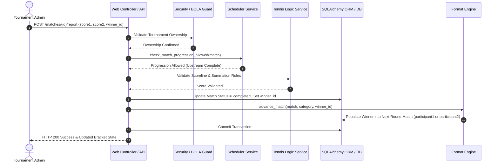

# TourneyPro — Technical & Software Architecture (ARCHITECTURE.md)

**Document Status:** Approved  
**Source of Truth:** Inherits from [`PRD.md`](file:///Users/rahilmehta24/VS_Code/Projects/TourneyPro/PRD.md) and [`DESIGN.md`](file:///Users/rahilmehta24/VS_Code/Projects/TourneyPro/DESIGN.md)  
**Architecture Version:** 2.0  
**Runtime:** Python 3.12.8 / Flask 3.1.3 / SQLAlchemy 2.0.51  
**Last Updated:** October 2026  

---

## 1. System Context & High-Level Architecture

TourneyPro follows a clean, modular monolith architecture with server-side rendered (SSR) web interfaces and a headless REST API layer sharing a unified domain and service foundation.

```
                              ┌───────────────────────────────────────────────┐
                              │            Clients / Presentation             │
                              │  - Web Browser (SSR Jinja2 + Vanilla CSS3)    │
                              │  - REST API Consumers (Mobile / External)     │
                              └──────────────────────┬────────────────────────┘
                                                     │ HTTP / HTTPS
                                                     ▼
                              ┌───────────────────────────────────────────────┐
                              │               Routing & Security              │
                              │  - WSGI Server (Gunicorn) / Vercel Serverless │
                              │  - CSRFProtect (Web) / JWT Bearer Auth (API)  │
                              │  - Flask-Compress (Brotli / Gzip)             │
                              └──────────────────────┬────────────────────────┘
                                                     │
                                                     ▼
                              ┌───────────────────────────────────────────────┐
                              │           Flask Application Factory           │
                              │                   create_app()                │
                              └──────────────────────┬────────────────────────┘
                                                     │
         ┌───────────────────┬───────────────────────┼────────────────────────┬───────────────────┐
         ▼                   ▼                       ▼                        ▼                   ▼
┌─────────────────┐ ┌─────────────────┐     ┌─────────────────┐      ┌─────────────────┐ ┌─────────────────┐
│  Tournament BP  │ │   Category BP   │     │    Player BP    │      │    Auth BP      │ │     API BP      │
│ (Setup/Courts)  │ │ (Brackets/Draw) │     │(Registry/Stats) │      │  (RBAC / BOLA)  │ │   (/api/v1/)    │
└────────┬────────┘ └────────┬────────┘     └────────┬────────┘      └────────┬────────┘ └────────┬────────┘
         │                   │                       │                        │                   │
         └───────────────────┴───────────────────────┼────────────────────────┴───────────────────┘
                                                     │
                                                     ▼
                              ┌───────────────────────────────────────────────┐
                              │                 Service Layer                 │
                              │  - Format Engine (Knockout, Group Stage, RR)  │
                              │  - Court Scheduler & Progression Engine       │
                              │  - Tennis Logic & Rubber Scorer               │
                              │  - Leaderboard & Statistics Calculator        │
                              │  - PDF Vector Export Generation Service       │
                              └──────────────────────┬────────────────────────┘
                                                     │
                                                     ▼
                              ┌───────────────────────────────────────────────┐
                              │           Domain & Persistence Layer          │
                              │  - SQLAlchemy 2.0 ORM Models                  │
                              │  - Marshmallow Schemas                        │
                              │  - Alembic Migrations & Schema Sync Engine    │
                              └──────────────────────┬────────────────────────┘
                                                     │
                           ┌─────────────────────────┴─────────────────────────┐
                           ▼                                                   ▼
              ┌─────────────────────────┐                         ┌─────────────────────────┐
              │ SQLite (Dev / Testing)  │                         │ PostgreSQL / Supabase   │
              │ (instance/tournaments.db)                         │ (Production / Staging)  │
              └─────────────────────────┘                         └─────────────────────────┘
```

---

## 2. Application Factory & Modular Blueprints

The application is initialized using the Application Factory Pattern in [`app/__init__.py`](file:///Users/rahilmehta24/VS_Code/Projects/TourneyPro/app/__init__.py) via `create_app(config_class=Config)`.

### 2.1 Blueprint Registry

| Blueprint | Controller Path | Responsibilities & Scope |
| :--- | :--- | :--- |
| `main_bp` | [`app/web/controllers/main.py`](file:///Users/rahilmehta24/VS_Code/Projects/TourneyPro/app/web/controllers/main.py) | Public landing page, search, and global index. |
| `tournament_bp` | [`app/web/controllers/tournament.py`](file:///Users/rahilmehta24/VS_Code/Projects/TourneyPro/app/web/controllers/tournament.py) | Tournament creation, settings, court management, and Order of Play rendering. |
| `category_bp` | [`app/web/controllers/category.py`](file:///Users/rahilmehta24/VS_Code/Projects/TourneyPro/app/web/controllers/category.py) | Category lifecycle, draw generation, team draft modes (A & B), rubber scoring, and match progression. |
| `player_bp` | [`app/web/controllers/player.py`](file:///Users/rahilmehta24/VS_Code/Projects/TourneyPro/app/web/controllers/player.py) | Global player registry, player profiles, win-rate metrics, and career records. |
| `leaderboard_bp`| [`app/web/controllers/leaderboard.py`](file:///Users/rahilmehta24/VS_Code/Projects/TourneyPro/app/web/controllers/leaderboard.py)| Tournament podiums and overall global player leaderboards. |
| `academy_bp` | [`app/web/controllers/academy.py`](file:///Users/rahilmehta24/VS_Code/Projects/TourneyPro/app/web/controllers/academy.py) | Academy hubs, club rosters, member roles, and internal tournaments. |
| `auth_bp` | [`app/web/controllers/auth.py`](file:///Users/rahilmehta24/VS_Code/Projects/TourneyPro/app/web/controllers/auth.py) | Authentication (login/logout/register), RBAC enforcement, BOLA decorators, and superadmin bootstrap. |
| `export_bp` | [`app/web/controllers/export.py`](file:///Users/rahilmehta24/VS_Code/Projects/TourneyPro/app/web/controllers/export.py) | High-performance PDF bracket/schedule downloads and Excel participant exports. |
| `api_bp` | [`app/api/__init__.py`](file:///Users/rahilmehta24/VS_Code/Projects/TourneyPro/app/api/__init__.py) | RESTful API (`/api/v1/`) with stateless JWT auth, exempt from CSRF. |

---

## 3. Service Layer Architecture

Business logic is strictly decoupled from web request handling into reusable domain services:

### 3.1 Format Engine (`app/services/format_engine/`)
An extensible strategy pattern managing tournament algorithms:
* `base.py`: Abstract base class defining `generate_bracket()`, `advance_match()`, and `get_standings()`.
* `single_elimination/`: Calculates power-of-2 geometry, balanced Bye distribution, and single-match knockout progression.
* `doubles_elimination/`: Manages pair entries and dual player score/point distribution.
* `round_robin/`: Exhaustive grid generation and cumulative game point aggregations.
* `group_stage/`: Multi-group team league logic, Mode A/B team drafting, 3-rubber fixture assembly, and Head-to-Head tiebreakers.

### 3.2 Court Scheduling Engine (`app/services/utils/scheduler.py`)
A comprehensive constraint satisfaction algorithm for tournament logistics:
* **Prerequisite Progression Checks:** Evaluates `check_match_progression_allowed(match)` ensuring no match is started before feeder matches complete.
* **Resource Conflict Resolution:** Enforces that a player is never scheduled simultaneously across courts or categories.
* **Rest Interval Compliance:** Guarantees `min_rest_minutes` (default 30 min) between successive matches for any participant.
* **Daily Schedule Distribution:** Balances matches across tournament days and operating hours (`court_operating_start` to `court_operating_end`).

### 3.3 Tennis & Scoring Logic (`app/services/tennis_logic.py`)
Handles parsing and validation of tennis scores:
* Validates set structures (Best of 1, 3, or 5).
* Handles tiebreak formatting (e.g. `7-6(5)`).
* Enforces summation rules for team rubbers ($G_1 + G_2 = 7$).
* Handles walkovers and mid-match retirements with automatic remainder game awards.

### 3.4 PDF Generation Engine (`app/services/pdf/`)
Generates vector PDF documents via `xhtml2pdf` and `reportlab`:
* `draw_adapter.py`: Adapts bracket hierarchies into printable vector layout models.
* `order_of_play_adapter.py`: Adapts court schedules into matrix layouts with time slots.
* `participants_adapter.py`: Adapts participant rosters and check-in tables.
* `pdf_generator.py`: Generates cached PDF binary streams with MD5 ETags and conditional HTTP 304 caching.

---

## 4. Dual Database & Storage Strategy

TourneyPro employs a dual database architecture configured in [`config.py`](file:///Users/rahilmehta24/VS_Code/Projects/TourneyPro/config.py):

### 4.1 SQLite (Local Development & Testing)
* Stored in [`instance/tournaments.db`](file:///Users/rahilmehta24/VS_Code/Projects/TourneyPro/instance/tournaments.db).
* Alembic migrations use `render_as_batch=True` to support table schema alterations without full table drop-and-recreate cycles.

### 4.2 PostgreSQL / Supabase (Cloud Staging & Production)
* Connected via `psycopg` (v3).
* Connection strings are sanitized to handle quotes and whitespace (`db_url.strip().strip("'\"")`).
* **PgBouncer Compatibility:** Set `pool_pre_ping=True` and `'prepare_threshold': None` in `SQLALCHEMY_ENGINE_OPTIONS` to support Supabase transaction poolers without prepared-statement name collisions.

### 4.3 Automated Schema Reconciliation Engine (`scripts/sync_db_schema.py`)
During production deployments (via GitHub Actions or CLI), this engine:
1. Inspects active database tables and column metadata via `sqlalchemy.inspect`.
2. Compares existing schemas against SQLAlchemy models in `app.domain.models`.
3. Issues idempotent `ALTER TABLE ... ADD COLUMN` statements for missing fields, preventing deployment crashes caused by unapplied migrations.

---

## 5. Security & Access Control Architecture

### 5.1 Broken Object Level Authorization (BOLA/IDOR) Defense
To prevent unauthorized organizers from mutating fixtures or settings of tournaments they do not own:
* Web routes enforce `check_tournament_ownership(tournament)`:
  ```python
  if user.role != 'superadmin' and tournament.user_id != user.id:
      abort(403)
  ```
* API routes verify the same logic using the JWT identity token:
  ```python
  if user.role != 'superadmin' and match.tournament.user_id != user.id:
      return jsonify({"success": False, "message": "Forbidden"}), 403
  ```

### 5.2 CSRF & API Token Isolation
* `CSRFProtect` is initialized globally across the web application.
* The API blueprint (`/api/v1/`) is explicitly exempted via `csrf.exempt(api_bp)`, relying exclusively on stateless JWT Bearer tokens in the `Authorization` header.

---

## 6. End-to-End Sequence Diagrams

### 6.1 Match Score Reporting & Progression Flow



---

## 7. Deployment & Infrastructure Architecture

* **Container / Standard Server:** Run via `gunicorn run:app -w 4 -b 0.0.0.0:5000`.
* **Serverless Hosting (Vercel):** Configured via [`vercel.json`](file:///Users/rahilmehta24/VS_Code/Projects/TourneyPro/vercel.json):
  ```json
  {
    "builds": [{ "src": "run.py", "use": "@vercel/python" }],
    "routes": [{ "src": "/(.*)", "dest": "run.py" }]
  }
  ```
  Cold starts are optimized by skipping schema checks when `os.environ.get('VERCEL')` is detected.
