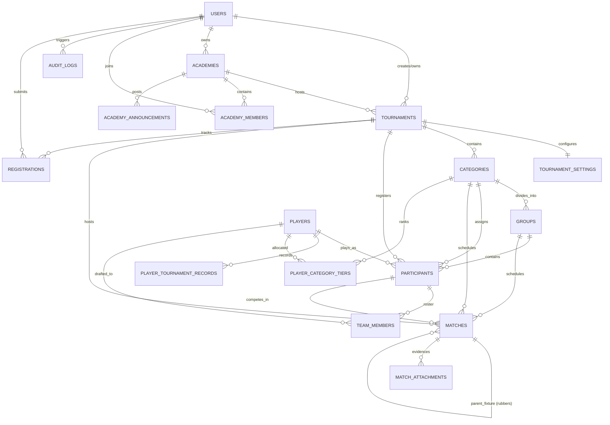

# TourneyPro — Database & Schema Architecture (DATABASE.md)

**Document Status:** Approved  
**Source of Truth:** Inherits from [`ARCHITECTURE.md`](file:///Users/rahilmehta24/VS_Code/Projects/TourneyPro/ARCHITECTURE.md) and [`PRD.md`](file:///Users/rahilmehta24/VS_Code/Projects/TourneyPro/PRD.md)  
**Database Engines:** PostgreSQL 15+ (Production / Staging via Supabase) & SQLite 3 (Development / Testing)  
**ORM:** SQLAlchemy 2.0.51 / Flask-SQLAlchemy 3.1.1  
**Migration Tooling:** Alembic 1.20.0 / Flask-Migrate 4.1.0  
**Last Updated:** October 2026  

---

## 1. Relational Entity Overview

TourneyPro manages 17 relational entities structured around the tournament execution lifecycle, global player registry, and academy club portals.



---

## 2. Exhaustive Table Specifications

### 2.1 `tournaments`
Root container for events, multi-day calendar windows, and venue court capacities.

| Column | Type | Constraints | Default | Description |
| :--- | :--- | :--- | :--- | :--- |
| `id` | `INTEGER` | Primary Key | Auto | Unique tournament identifier. |
| `user_id` | `INTEGER` | FK (`users.id`) | Nullable | Creator/owner account (BOLA authorization anchor). |
| `creator_name` | `VARCHAR(100)` | Nullable | NULL | Display name of creator. |
| `name` | `VARCHAR(200)` | NOT NULL | - | Official tournament title. |
| `url_slug` | `VARCHAR(200)` | UNIQUE, NOT NULL | - | Public URL slug (e.g., `monsoon-open-2026`). |
| `description` | `TEXT` | Nullable | NULL | Overview, eligibility, rules, and venue details. |
| `game_info` | `VARCHAR(200)` | Nullable | NULL | Sport / game classification (e.g. Lawn Tennis, Pickleball). |
| `format` | `VARCHAR(50)` | Nullable | NULL | Legacy format field kept for backwards compatibility. |
| `tournament_type` | `VARCHAR(20)`| Nullable | `'single_stage'` | Multi-stage or single stage indicator. |
| `status` | `VARCHAR(20)` | Nullable | `'setup'` | Lifecycle state: `setup`, `registration`, `in_progress`, `completed`. |
| `max_participants`| `INTEGER` | Nullable | NULL | Global tournament capacity limit. |
| `is_private` | `BOOLEAN` | Nullable | `FALSE` | Access visibility restriction flag. |
| `has_categories` | `BOOLEAN` | Nullable | `FALSE` | Flag denoting multi-category architecture. |
| `created_at` | `DATETIME` | Nullable | `utcnow` | Creation timestamp. |
| `started_at` | `DATETIME` | Nullable | NULL | Official commencement timestamp. |
| `completed_at` | `DATETIME` | Nullable | NULL | Official conclusion timestamp. |
| `num_sets` | `INTEGER` | Nullable | `1` | Default sets per match. |
| `games_per_set` | `INTEGER` | Nullable | `6` | Default games to win a set. |
| `payment_upi_id` | `VARCHAR(100)` | Nullable | NULL | Organizer's UPI ID for direct registration payments. |
| `registration_closes_at` | `DATETIME` | Nullable | NULL | Registration deadline in UTC. |
| `academy_id` | `INTEGER` | FK (`academies.id`) | Nullable | Associated academy club container. |
| `is_internal` | `BOOLEAN` | Nullable | `FALSE` | Restricts registrations to academy members only. |
| `start_date` | `DATE` | Nullable | NULL | Tournament opening date. |
| `end_date` | `DATE` | Nullable | NULL | Tournament concluding date. |
| `num_courts` | `INTEGER` | Nullable | `1` | Total physical courts available. |
| `court_names` | `TEXT` | Nullable | NULL | JSON or comma-separated list of court names. |
| `court_operating_start` | `VARCHAR(5)` | Nullable | `'08:00'` | Daily earliest start time (`HH:MM`). |
| `court_operating_end` | `VARCHAR(5)` | Nullable | `'20:00'` | Daily concluding time (`HH:MM`). |
| `daily_operating_hours` | `TEXT` | Nullable | NULL | JSON map of date -> `{"start": "HH:MM", "end": "HH:MM"}`. |
| `avg_match_duration` | `INTEGER` | Nullable | `60` | Estimated match length in minutes for scheduling. |
| `court_buffer_minutes` | `INTEGER` | Nullable | `10` | Rest turnaround between matches on the same court. |
| `min_rest_minutes` | `INTEGER` | Nullable | `30` | Mandatory player rest buffer between consecutive matches. |
| `max_matches_per_player_day` | `INTEGER` | Nullable | `3` | Safety cap preventing player overexertion per calendar day. |

---

### 2.2 `categories`
Sub-events within a tournament (e.g., Men's Singles, Under-14, Team League).

| Column | Type | Constraints | Default | Description |
| :--- | :--- | :--- | :--- | :--- |
| `id` | `INTEGER` | Primary Key | Auto | Unique category identifier. |
| `tournament_id` | `INTEGER` | FK (`tournaments.id`), NOT NULL | - | Parent tournament container. |
| `name` | `VARCHAR(200)` | NOT NULL | - | Category title (e.g. "Men's Singles 45+"). |
| `gender` | `VARCHAR(50)` | Nullable | `'Unspecified'`| Gender eligibility (Men, Women, Mixed, Open). |
| `age_category` | `VARCHAR(50)` | Nullable | `'Unspecified'`| Age division (U10, U12, U14, U16, U18, Open, 35+, 45+). |
| `format` | `VARCHAR(50)` | NOT NULL | - | `single_elimination`, `double_elimination`, `round_robin`, `group_stage`. |
| `status` | `VARCHAR(20)` | Nullable | `'setup'` | Category lifecycle: `setup`, `in_progress`, `completed`. |
| `max_participants` | `INTEGER` | Nullable | NULL | Entry cap for this specific event. |
| `created_at` | `DATETIME` | Nullable | `utcnow` | Creation timestamp. |
| `started_at` | `DATETIME` | Nullable | NULL | Bracket generation timestamp. |
| `completed_at` | `DATETIME` | Nullable | NULL | Category conclusion timestamp. |
| `num_sets` | `INTEGER` | Nullable | `1` | Match sets (1, 3, or 5). |
| `games_per_set` | `INTEGER` | Nullable | `6` | Games required to capture a set. |
| `entry_fee` | `FLOAT` | Nullable | `0.0` | Entry fee amount per participant. |
| `has_group_stage` | `BOOLEAN` | Nullable | `FALSE` | Flags group stage phase. |
| `num_groups` | `INTEGER` | Nullable | NULL | Pool count for group stage (e.g. 2, 4). |
| `teams_per_group` | `INTEGER` | Nullable | NULL | Number of teams/participants per pool. |
| `matches_per_team_pair`| `INTEGER`| Nullable | `1` | Round-robin meetings between teams in group. |
| `qualifiers_per_group` | `INTEGER`| Nullable | NULL | Number of top teams advancing to knockout. |
| `allow_lucky_losers` | `BOOLEAN` | Nullable | `FALSE` | Knockout wildcard qualification flag. |
| `max_players_per_team` | `INTEGER`| Nullable | NULL | Maximum roster size per team. |
| `total_games` | `INTEGER` | Nullable | NULL | Target game cap per match. |
| `scoring_format` | `VARCHAR(20)`| Nullable | `'games'` | `'games'` (cumulative points) or `'points'`. |
| `points_to_win` | `INTEGER` | Nullable | `11` | Win threshold (e.g., first to 11 in 21-game tie). |
| `start_date` | `DATE` | Nullable | NULL | Category opening date. |
| `end_date` | `DATE` | Nullable | NULL | Category concluding date. |
| `start_time` | `VARCHAR(5)` | Nullable | `'09:00'` | Daily start time (`HH:MM`). |
| `end_time` | `VARCHAR(5)` | Nullable | `'19:00'` | Daily wrap-up time (`HH:MM`). |
| `daily_schedule` | `TEXT` | Nullable | NULL | JSON mapping date -> `{"start": "HH:MM", "end": "HH:MM"}`. |
| `num_courts` | `INTEGER` | Nullable | `1` | Dedicated courts for category. |
| `court_names` | `TEXT` | Nullable | NULL | JSON or comma-separated list of assigned courts. |
| `avg_match_duration` | `INTEGER` | Nullable | `60` | Estimated match duration (minutes). |
| `preferred_start_day` | `INTEGER` | Nullable | `1` | Staggered start offset (Day 1, Day 2). |
| `pin_finals_to_last_day`| `BOOLEAN`| Nullable | `TRUE` | Keeps championship match on closing day. |

---

### 2.3 `groups`
Group stage pools (e.g., "Group A", "Group B") within multi-stage tournaments.

| Column | Type | Constraints | Default | Description |
| :--- | :--- | :--- | :--- | :--- |
| `id` | `INTEGER` | Primary Key | Auto | Group identifier. |
| `category_id` | `INTEGER` | FK (`categories.id`), NOT NULL | - | Parent category. |
| `name` | `VARCHAR(50)` | NOT NULL | - | Pool designation (e.g. "Group A"). |
| `start_time` | `VARCHAR(10)` | Nullable | NULL | Scheduled session start time (`HH:MM`). |
| `assigned_courts` | `VARCHAR(100)` | Nullable | NULL | Assigned court cluster (`Court 1, Court 2`). |
| `created_at` | `DATETIME` | Nullable | `utcnow` | Creation timestamp. |

---

### 2.4 `participants`
Individual players, doubles pairs, or teams registered to compete in an event.

| Column | Type | Constraints | Default | Description |
| :--- | :--- | :--- | :--- | :--- |
| `id` | `INTEGER` | Primary Key | Auto | Participant entry identifier. |
| `tournament_id` | `INTEGER` | FK (`tournaments.id`), NOT NULL | - | Associated tournament. |
| `category_id` | `INTEGER` | FK (`categories.id`), Nullable | NULL | Associated category event. |
| `group_id` | `INTEGER` | FK (`groups.id`), Nullable | NULL | Pool assignment in group stages. |
| `player_id` | `INTEGER` | FK (`players.id`), Nullable | NULL | Global player profile link (Primary / Player 1). |
| `player2_id` | `INTEGER` | FK (`players.id`), Nullable | NULL | Global player profile link (Partner / Player 2 for Doubles). |
| `partner_name` | `VARCHAR(100)` | Nullable | NULL | Unregistered partner name. |
| `partner_mobile` | `VARCHAR(20)` | Nullable | NULL | Partner phone number. |
| `name` | `VARCHAR(100)` | NOT NULL | - | Participant display name (or Pair/Team name). |
| `email` | `VARCHAR(120)` | Nullable | NULL | Contact email address. |
| `mobile` | `VARCHAR(20)` | Nullable | NULL | Contact phone number. |
| `gender` | `VARCHAR(20)` | Nullable | NULL | Gender. |
| `dob` | `DATE` | Nullable | NULL | Date of birth for age verification. |
| `seed` | `INTEGER` | Nullable | NULL | Auto-computed seeding rank. |
| `manual_seed` | `INTEGER` | Nullable | NULL | Manually assigned seed taking absolute priority. |
| `checked_in` | `BOOLEAN` | Nullable | `FALSE` | Venue on-site presence check-in flag. |
| `eliminated` | `BOOLEAN` | Nullable | `FALSE` | Knockout elimination status. |
| `final_rank` | `INTEGER` | Nullable | NULL | Final placement: `1` (Winner), `2` (Runner-up), `3` (Semi-finalist). |
| `group_wins` | `INTEGER` | Nullable | `0` | Wins in pool play. |
| `group_losses` | `INTEGER` | Nullable | `0` | Losses in pool play. |
| `group_points` | `INTEGER` | Nullable | `0` | Cumulative points in pool play. |
| `payment_status` | `VARCHAR(20)` | Nullable | `'paid'` | `pending`, `paid`, `refunded`. |
| `payment_method` | `VARCHAR(50)` | Nullable | NULL | `online`, `cash`, `free`. |
| `created_at` | `DATETIME` | Nullable | `utcnow` | Registration timestamp. |

---

### 2.5 `matches`
Fixtures, matches, sets, rubbers, and court scheduling slots.

| Column | Type | Constraints | Default | Description |
| :--- | :--- | :--- | :--- | :--- |
| `id` | `INTEGER` | Primary Key | Auto | Match identifier. |
| `tournament_id` | `INTEGER` | FK (`tournaments.id`), NOT NULL | - | Associated tournament. |
| `category_id` | `INTEGER` | FK (`categories.id`), Nullable | NULL | Associated category. |
| `group_id` | `INTEGER` | FK (`groups.id`), Nullable | NULL | Associated group stage pool. |
| `round` | `INTEGER` | NOT NULL | - | Round sequence number (1, 2, 3...). |
| `match_number` | `INTEGER` | NOT NULL | - | Match position within the round. |
| `participant1_id` | `INTEGER` | FK (`participants.id`), Nullable | NULL | Competitor 1 reference. |
| `participant2_id` | `INTEGER` | FK (`participants.id`), Nullable | NULL | Competitor 2 reference. |
| `winner_id` | `INTEGER` | FK (`participants.id`), Nullable | NULL | Victorious competitor reference. |
| `score1` | `VARCHAR(50)` | Nullable | NULL | Scoreline string for Competitor 1. |
| `score2` | `VARCHAR(50)` | Nullable | NULL | Scoreline string for Competitor 2. |
| `bracket_type` | `VARCHAR(20)` | Nullable | `'main'` | Bracket stream (`main`, `winners`, `losers`). |
| `match_type` | `VARCHAR(20)` | Nullable | `'knockout'` | Format (`knockout`, `group_stage`, `round_robin`). |
| `status` | `VARCHAR(20)` | Nullable | `'pending'` | State: `pending`, `in_progress`, `completed`. |
| `scheduled_time` | `DATETIME` | Nullable | NULL | Official scheduled start datetime. |
| `scheduled_date` | `DATE` | Nullable | NULL | Calendar match day. |
| `scheduled_end_time`| `DATETIME` | Nullable | NULL | Estimated finish datetime. |
| `is_not_before` | `BOOLEAN` | Nullable | `FALSE` | "Not Before [Time]" flexible scheduling flag. |
| `court_name` | `VARCHAR(100)` | Nullable | NULL | Assigned court string (e.g. `Court 1`). |
| `completed_at` | `DATETIME` | Nullable | NULL | Conclusion timestamp. |
| `scoring_format` | `VARCHAR(20)` | Nullable | NULL | Match-level scoring override. |
| `num_sets` | `INTEGER` | Nullable | NULL | Match-level set override. |
| `games_per_set` | `INTEGER` | Nullable | NULL | Match-level game override. |
| `points_to_win` | `INTEGER` | Nullable | NULL | Match-level points override. |
| `parent_match_id` | `INTEGER` | FK (`matches.id`, CASCADE), Nullable | NULL | Parent tie fixture for child rubbers. |
| `rubber_type` | `VARCHAR(20)` | Nullable | NULL | Rubber designation (`singles`, `doubles_1`, `doubles_2`). |
| `rubber_number` | `INTEGER` | Nullable | NULL | Rubber sequence within tie (`1`, `2`, `3`). |
| `p1_player1_id` | `INTEGER` | FK (`players.id`), Nullable | NULL | Rubber lineup: Team 1 Primary Player. |
| `p1_player2_id` | `INTEGER` | FK (`players.id`), Nullable | NULL | Rubber lineup: Team 1 Doubles Partner. |
| `p2_player1_id` | `INTEGER` | FK (`players.id`), Nullable | NULL | Rubber lineup: Team 2 Primary Player. |
| `p2_player2_id` | `INTEGER` | FK (`players.id`), Nullable | NULL | Rubber lineup: Team 2 Doubles Partner. |

---

### 2.6 `tournament_settings`
Granular feature toggles per tournament.

| Column | Type | Constraints | Default | Description |
| :--- | :--- | :--- | :--- | :--- |
| `id` | `INTEGER` | Primary Key | Auto | Identifier. |
| `tournament_id` | `INTEGER` | FK (`tournaments.id`), UNIQUE, NOT NULL | - | 1-to-1 relationship with tournament. |
| `allow_self_registration`| `BOOLEAN`| Nullable | `FALSE` | Enables public self-registration button. |
| `require_check_in` | `BOOLEAN` | Nullable | `FALSE` | Enforces mandatory on-site check-in. |
| `allow_match_attachments`| `BOOLEAN`| Nullable | `FALSE` | Allows photo/scoresheet uploads per match. |
| `hide_seeds` | `BOOLEAN` | Nullable | `FALSE` | Hides numeric seeds on public bracket views. |
| `quick_advance` | `BOOLEAN` | Nullable | `FALSE` | Enables 1-click winner advancement without scores. |
| `custom_round_labels` | `TEXT` | Nullable | NULL | JSON string of custom round titles. |
| `registration_fields` | `TEXT` | Nullable | NULL | JSON string configuring custom sign-up questions. |

---

### 2.7 `match_attachments`
Scorecards, signed match sheets, or photo evidence uploaded for completed fixtures.

| Column | Type | Constraints | Default | Description |
| :--- | :--- | :--- | :--- | :--- |
| `id` | `INTEGER` | Primary Key | Auto | Attachment identifier. |
| `match_id` | `INTEGER` | FK (`matches.id`), NOT NULL | - | Associated match. |
| `participant_id` | `INTEGER` | FK (`participants.id`), NOT NULL | - | Uploader/participant. |
| `file_path` | `VARCHAR(500)` | NOT NULL | - | Relative path in `app/web/static/uploads/`. |
| `uploaded_at` | `DATETIME` | Nullable | `utcnow` | Upload timestamp. |

---

### 2.8 `users`
System accounts for authentication, authorization, and ownership.

| Column | Type | Constraints | Default | Description |
| :--- | :--- | :--- | :--- | :--- |
| `id` | `INTEGER` | Primary Key | Auto | User identifier. |
| `username` | `VARCHAR(80)` | UNIQUE, NOT NULL | - | Login handle. |
| `email` | `VARCHAR(120)` | UNIQUE, NOT NULL | - | Account email address. |
| `password_hash` | `VARCHAR(256)` | NOT NULL | - | Secure Werkzeug PBKDF2-HMAC-SHA256 hash. |
| `role` | `VARCHAR(20)` | Nullable | `'user'` | Role: `superadmin`, `admin`, `user`, `deleted`. |
| `admin_requested` | `BOOLEAN` | Nullable | `FALSE` | Flag indicating user requested organizer privileges. |
| `created_at` | `DATETIME` | Nullable | `utcnow` | Account registration datetime. |

---

### 2.9 `players`
Global player registry tracking lifetime athlete statistics and personal portfolios.

| Column | Type | Constraints | Default | Description |
| :--- | :--- | :--- | :--- | :--- |
| `id` | `INTEGER` | Primary Key | Auto | Player registry identifier. |
| `user_id` | `INTEGER` | FK (`users.id`), Nullable | NULL | Linked user authentication account (if claimed). |
| `name` | `VARCHAR(100)` | NOT NULL | - | Athlete full name. |
| `registration_no` | `VARCHAR(100)` | Nullable | NULL | Federation / Association registration code. |
| `dob` | `DATE` | Nullable | NULL | Date of birth. |
| `email` | `VARCHAR(120)` | Nullable | NULL | Player email. |
| `contact_number` | `VARCHAR(50)` | Nullable | NULL | Phone / WhatsApp number. |
| `height` | `VARCHAR(50)` | Nullable | NULL | Physical metric (e.g., `182 cm`). |
| `weight` | `VARCHAR(50)` | Nullable | NULL | Physical metric (e.g., `75 kg`). |
| `gender` | `VARCHAR(20)` | NOT NULL | - | `Boys`, `Girls`, `Mens`, `Womens`. |
| `blood_group` | `VARCHAR(10)` | Nullable | NULL | Emergency medical blood group. |
| `nationality` | `VARCHAR(100)` | Nullable | NULL | Country of origin. |
| `address` | `TEXT` | Nullable | NULL | Residential address. |
| `coach` | `VARCHAR(100)` | Nullable | NULL | Primary coach name. |
| `academy` | `VARCHAR(100)` | Nullable | NULL | Primary club affiliation string. |
| `registration_details`| `TEXT` | Nullable | NULL | Federation licensing details. |
| `registration_date` | `DATE` | Nullable | NULL | License issuance date. |
| `registration_validity`| `DATE` | Nullable | NULL | License expiration date. |
| `current_status` | `VARCHAR(50)` | Nullable | `'Active'` | `Active`, `Injured`, `Suspended`. |
| `age_category` | `VARCHAR(20)` | NOT NULL | - | Inferred category (`U12`, `U14`, `Open`, `35+`). |
| `avatar_url` | `VARCHAR(500)` | Nullable | NULL | Profile picture path. |
| `bio` | `TEXT` | Nullable | NULL | Athlete biography. |
| `total_points` | `FLOAT` | Nullable | `0.0` | Lifetime cumulative ranking points. |
| `matches_played` | `INTEGER` | Nullable | `0` | Career matches count. |
| `matches_won` | `INTEGER` | Nullable | `0` | Career matches won. |
| `matches_lost` | `INTEGER` | Nullable | `0` | Career matches lost. |
| `created_at` | `DATETIME` | Nullable | `utcnow` | Record creation timestamp. |

---

### 2.10 `player_tournament_records`
Historical tournament finishes (Podiums, Points) earned by an athlete.

| Column | Type | Constraints | Default | Description |
| :--- | :--- | :--- | :--- | :--- |
| `id` | `INTEGER` | Primary Key | Auto | Record identifier. |
| `player_id` | `INTEGER` | FK (`players.id`), NOT NULL | - | Athlete reference. |
| `tournament_name` | `VARCHAR(200)` | NOT NULL | - | Tournament event name. |
| `level` | `VARCHAR(50)` | Nullable | `'Regular'` | Competition tier: `Regular`, `State`, `National`. |
| `round_reached` | `VARCHAR(50)` | Nullable | NULL | `Winner`, `Runner-up`, `SF`, `QF`, `Round 1`. |
| `points_earned` | `FLOAT` | Nullable | `0.0` | Ranking points awarded for finish. |
| `is_manual` | `BOOLEAN` | Nullable | `FALSE` | Flag for manually imported historical results. |
| `date_recorded` | `DATETIME` | Nullable | `utcnow` | Entry timestamp. |

---

### 2.11 `player_category_tiers`
Player skill ratings and roles for Team League drafts within a category.

| Column | Type | Constraints | Default | Description |
| :--- | :--- | :--- | :--- | :--- |
| `id` | `INTEGER` | Primary Key | Auto | Tier record identifier. |
| `category_id` | `INTEGER` | FK (`categories.id`), NOT NULL | - | Category event context. |
| `player_id` | `INTEGER` | FK (`players.id`), NOT NULL | - | Athlete reference. |
| `tier` | `VARCHAR(10)` | NOT NULL | - | Skill tier classification: `'A'`, `'B'`, `'C'`, `'D'`, `'E'`. |
| `role` | `VARCHAR(20)` | Nullable | `'player'` | Role: `'captain'`, `'vice_captain'`, `'player'`. |
| `is_drafted` | `BOOLEAN` | Nullable | `FALSE` | Draft status flag. |
| `created_at` | `DATETIME` | Nullable | `utcnow` | Creation timestamp. |

---

### 2.12 `team_members`
Association table linking drafted players into team rosters.

| Column | Type | Constraints | Default | Description |
| :--- | :--- | :--- | :--- | :--- |
| `id` | `INTEGER` | Primary Key | Auto | Membership identifier. |
| `participant_id` | `INTEGER` | FK (`participants.id`), NOT NULL | - | Team entry reference. |
| `player_id` | `INTEGER` | FK (`players.id`), NOT NULL | - | Athlete reference. |
| `role` | `VARCHAR(20)` | Nullable | `'member'` | `'captain'`, `'vice_captain'`, `'member'`. |
| `tier` | `VARCHAR(10)` | Nullable | NULL | Player's tier in this team (`A` through `E`). |
| `roster_order` | `INTEGER` | Nullable | `1` | Playing slot order (1 to 5). |
| `created_at` | `DATETIME` | Nullable | `utcnow` | Draft timestamp. |

---

### 2.13 `audit_logs`
Security and administrative mutation ledger.

| Column | Type | Constraints | Default | Description |
| :--- | :--- | :--- | :--- | :--- |
| `id` | `INTEGER` | Primary Key | Auto | Audit record identifier. |
| `user_id` | `INTEGER` | FK (`users.id`), NOT NULL | - | Acting user identifier. |
| `action_type` | `VARCHAR(100)`| NOT NULL | - | Action tag (e.g., `RESET_BRACKET`, `UPDATE_SCORE`). |
| `target_id` | `INTEGER` | Nullable | NULL | Entity ID modified. |
| `target_name` | `VARCHAR(200)`| Nullable | NULL | Human-readable target name. |
| `reason` | `VARCHAR(100)`| NOT NULL | - | Justification tag. |
| `explanation` | `TEXT` | Nullable | NULL | Detailed organizer remarks. |
| `details` | `TEXT` | Nullable | NULL | JSON diff of modified attributes. |
| `created_at` | `DATETIME` | Nullable | `utcnow` | Action timestamp. |

---

### 2.14 `registrations`
Self-service tournament registration and payment tracking entries.

| Column | Type | Constraints | Default | Description |
| :--- | :--- | :--- | :--- | :--- |
| `id` | `INTEGER` | Primary Key | Auto | Registration identifier. |
| `tournament_id` | `INTEGER` | FK (`tournaments.id`), NOT NULL | - | Tournament registered for. |
| `category_id` | `INTEGER` | FK (`categories.id`), Nullable | NULL | Specific category event. |
| `user_id` | `INTEGER` | FK (`users.id`), NOT NULL | - | Submitting user account. |
| `player_id` | `INTEGER` | FK (`players.id`), NOT NULL | - | Primary athlete profile. |
| `player2_id` | `INTEGER` | FK (`players.id`), Nullable | NULL | Doubles partner athlete profile. |
| `partner_name` | `VARCHAR(100)` | Nullable | NULL | Partner display name. |
| `partner_mobile` | `VARCHAR(20)` | Nullable | NULL | Partner phone number. |
| `status` | `VARCHAR(20)` | Nullable | `'pending'` | Registration approval state: `pending`, `approved`, `rejected`. |
| `payment_status` | `VARCHAR(20)` | Nullable | `'pending'` | Payment status: `pending`, `paid`, `refunded`. |
| `amount_due` | `FLOAT` | Nullable | `0.0` | Entry fee billed. |
| `transaction_id` | `VARCHAR(100)` | Nullable | NULL | User-submitted UPI payment reference. |
| `payment_method` | `VARCHAR(50)` | Nullable | NULL | `online`, `cash`, `free`. |
| `created_at` | `DATETIME` | Nullable | `utcnow` | Submission timestamp. |

*Unique Constraint:* `uq_tournament_category_player` on `(tournament_id, category_id, player_id)` prevents duplicate applications.

---

### 2.15 `academies`
Club / Academy organizational umbrellas.

| Column | Type | Constraints | Default | Description |
| :--- | :--- | :--- | :--- | :--- |
| `id` | `INTEGER` | Primary Key | Auto | Academy identifier. |
| `name` | `VARCHAR(200)` | NOT NULL | - | Academy organization name. |
| `url_slug` | `VARCHAR(200)` | UNIQUE, NOT NULL | - | Academy public slug (e.g. `/academy/apex-tennis`). |
| `description` | `TEXT` | Nullable | NULL | Club bio, amenities, and location. |
| `owner_id` | `INTEGER` | FK (`users.id`), NOT NULL | - | Directing user account. |
| `created_at` | `DATETIME` | Nullable | `utcnow` | Creation timestamp. |

---

### 2.16 `academy_members`
Roster memberships linking users to academies with access roles.

| Column | Type | Constraints | Default | Description |
| :--- | :--- | :--- | :--- | :--- |
| `id` | `INTEGER` | Primary Key | Auto | Member identifier. |
| `academy_id` | `INTEGER` | FK (`academies.id`), NOT NULL | - | Associated academy. |
| `user_id` | `INTEGER` | FK (`users.id`), NOT NULL | - | Associated user account. |
| `role` | `VARCHAR(50)` | Nullable | `'member'` | Club role: `'admin'`, `'coach'`, `'member'`. |
| `joined_at` | `DATETIME` | Nullable | `utcnow` | Join timestamp. |

---

### 2.17 `academy_announcements`
Internal club bulletins and tournament notices.

| Column | Type | Constraints | Default | Description |
| :--- | :--- | :--- | :--- | :--- |
| `id` | `INTEGER` | Primary Key | Auto | Bulletin identifier. |
| `academy_id` | `INTEGER` | FK (`academies.id`), NOT NULL | - | Associated academy. |
| `author_id` | `INTEGER` | FK (`users.id`), NOT NULL | - | Author user account. |
| `title` | `VARCHAR(200)` | NOT NULL | - | Announcement title. |
| `content` | `TEXT` | NOT NULL | - | Bulletin message body. |
| `created_at` | `DATETIME` | Nullable | `utcnow` | Publishing timestamp. |

---

## 3. Database Migration & Schema Synchronization

### 3.1 Migration Strategy with Flask-Migrate & Alembic
* Migrations reside in [`migrations/versions/`](file:///Users/rahilmehta24/VS_Code/Projects/TourneyPro/migrations/versions/).
* To support schema alterations on local SQLite development databases without recreating tables, `render_as_batch=True` is enabled in [`app/__init__.py`](file:///Users/rahilmehta24/VS_Code/Projects/TourneyPro/app/__init__.py):
  ```python
  migrate.init_app(app, db, render_as_batch=True)
  ```

### 3.2 Schema Reconciliation Script (`scripts/sync_db_schema.py`)
In automated CI/CD deployment pipelines (e.g. Supabase production deployments), `scripts/sync_db_schema.py` is executed to safely reconcile discrepancies:
1. Inspects active PostgreSQL tables and columns.
2. Compares active structure against SQLAlchemy model declarations.
3. Automatically executes non-destructive `CREATE TABLE` and `ALTER TABLE ... ADD COLUMN` commands for missing elements.
