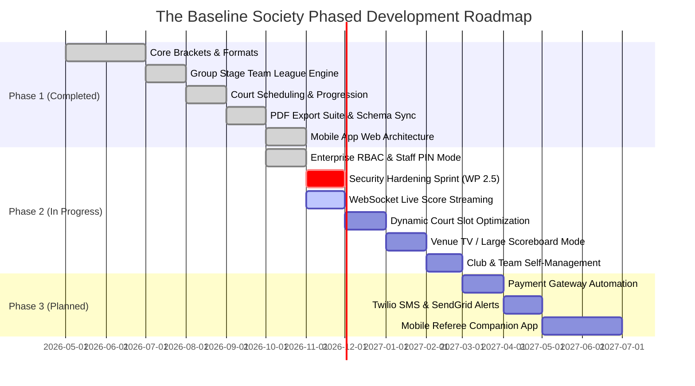

# The Baseline Society — Phased Delivery Roadmap & Execution Plan (PLAN.md)

**Document Status:** Approved  
**Source of Truth:** Inherits from [`README.md`](README.md), [`PRD.md`](PRD.md), and [`ARCHITECTURE.md`](ARCHITECTURE.md)  
**Current Milestone:** Baseline Society Core Platform (Phases 0–11) 100% Completed & Verified (164/164 tests passing)  
**Last Updated:** November 2026  

---

## 1. Roadmap Overview & Strategic Objectives

The Baseline Society's product roadmap is structured into three iterative phases to balance immediate operational reliability with long-term real-time automation:

---

## 2. Phase 1: Core Lifecycle & Ecosystem (✅ COMPLETED)

Phase 1 established the stable operational foundation of The Baseline Society, replacing legacy manual spreadsheets and paper draw sheets.

### 2.1 Completed Milestones & Capabilities
1. **Mathematical Tournament Formats:**
   * Single Elimination & Doubles Elimination with automatic power-of-2 ($2^k$) Bye distribution for top seeds.
   * Round Robin leagues with cumulative game point ranking and optional 1-click knockout phase transitions.
   * Group Stage Team Leagues featuring 3-rubber fixtures (Singles 1, Doubles, Singles 2), the $T=7$ summation rule, first-to-11 tie victories, and mid-match walkover remainder scoring.
   * Team draft wizards: Mode A (Manual Chit Draw with duplicate prevention) and Mode B (Auto-balanced Tier A-E draft).
2. **Order of Play & Court Logistics Engine:**
   * Multi-day tournament calendars with daily operating hours (`08:00` to `20:00`) and individual court rosters.
   * **Progression Locks:** Downstream matches are locked until upstream feeder matches conclude.
   * **Player Conflict Prevention:** Prevents players registered in multiple categories from being double-booked, enforcing a mandatory 30-minute rest buffer between matches.
3. **Smart Guest Registration & Player Registry:**
   * Guest athletes can register without creating user accounts; system auto-provisions global `Player` profiles.
   * Lifetime statistics tracking: Matches played, won, lost, win rates, and podium finishes.
4. **Vector PDF Export Suite:**
   * High-fidelity printable vector PDF downloads for Draws, Order of Play, and Participant Rosters via `xhtml2pdf` and `reportlab`.
5. **Quality Assurance & Deployment Automation:**
   * 72 automated unit and integration tests at Phase 1 close (82 after WP 2.0 added RBAC tests).
   * GitHub Actions CI quality gates and automated database schema synchronization (`scripts/sync_db_schema.py`) for Supabase PostgreSQL.
6. **Mobile Responsive Web App & Touch Experience:**
   * Safe-area notch and home indicator support (`viewport-fit=cover`, `env(safe-area-inset-bottom)`).
   * Glassmorphic off-canvas navigation drawer with frosted backdrop blur and tap dismissal.
   * Thumb-friendly mobile sticky bottom navigation bar (`#mobileBottomBar`).
   * Hardware-accelerated bracket touch drag panning and round-by-round pill jump tabs maintaining horizontal SVG connector coordinate geometry.
   * Bottom sheet score reporting modal on `≤ 640px` with dynamic viewport units (`dvh`), sticky action footers, and native numeric keypads (`inputmode="numeric"`).
   * 1-tap mobile UPI intent links (`upi://pay`) and 1-tap clipboard copying.
   * Smooth horizontal momentum table scrolling with sticky leading rank/player columns.

---

## 3. Phase 2: Enhanced Real-Time Tournament Operations (⚡ ACTIVE)

Phase 2 focuses on modernizing tournament venues with real-time score feeds and automated court slot assignment.

### 3.1 Work Packages

#### WP 2.0: Enterprise RBAC, Staff Delegation & Court PIN Mode (✅ COMPLETED)
* **Objective:** Secure tournament administration, enable operational delegation, and provide on-court tablet scorekeeping.
* **Delivered Capabilities:**
  * **Relational Staff Delegation:** Created `tournament_staff` table linking tournaments, users, and roles (canonical: `manager`, `official`, `scorer`, with the owner held in `tournaments.user_id`; legacy `tournament_admin`/`desk`/`umpire` are being migrated). Appoint, edit, and revoke staff via `/tournaments/<slug>/staff`.
  * **Court PIN Fast Entry:** Dedicated tablet scoring at `/tournaments/<slug>/court-pin` without individual user accounts. The original tournament-wide 4-digit PIN is superseded by **Court PIN v2** (6-digit, expiring, court-bound PINs stored hashed in `tournament_staff`; see WP 2.5).
  * **Draft Draw State Machine:** Added `draw_published` to `Category`. Brackets remain hidden from public viewers until organizers review and publish.
  * **Sporting Integrity & Anti-Conflict Guard:** Blocked active participants from scoring or officiating their own matches (`HTTP 403 Forbidden`).
  * **Optimistic Concurrency Control:** Added `lock_version` to `Match` records to eliminate simultaneous referee score overwrites (`HTTP 409 Conflict`).
  * **Automated Verification:** Added 10 automated test scenarios in `tests/test_rbac.py` bringing test suite to 82/82 passing tests.
  * **End-User Manual Suite:** Generated non-technical web manual [`docs/USER_MANUAL.md`](USER_MANUAL.md) and 6-page vector PDF guide [`docs/TourneyPro_User_Manual.pdf`](TourneyPro_User_Manual.pdf).

#### WP 2.1: Real-Time Score Updates via WebSockets
* **Objective:** Replace current 5-second HTTP polling (`/api/v1/live/<slug>/scores`) with instantaneous WebSocket push events.
* **Architecture:**
  * Integrate `Flask-SocketIO` with an event-driven broadcast channel per tournament room (`tournament_<slug>`).
  * When an organizer reports a score via the modal or API, emit a `score_update` event with payload `{ match_id, score1, score2, status, winner_id }`.
  * Public web client subscribes to the socket room; DOM nodes update with subtle flash animations without full page reloads.
* **Platform constraint:** Vercel serverless functions cannot hold WebSocket connections, so Flask-SocketIO cannot be deployed there. Decide first between (A) CDN-cached polling with ETag (no new infrastructure), (B) a managed realtime service (Supabase Realtime, Ably, Pusher), or (C) moving the app tier to a container host with Redis. Recommended: A now, B if sub-second latency is needed. Polling remains the fallback in every option (see [`ARCHITECTURE.md`](ARCHITECTURE.md) §7).

#### WP 2.2: Dynamic Match Scheduling & Court Assignment
* **Objective:** Move from manual court assignment to automated constraint optimization.
* **Algorithm Requirements:**
  * Calculate round dependencies dynamically.
  * Auto-assign the next eligible match to the first court that becomes free.
  * Predict match end times dynamically based on sport averages and historical set counts.

#### WP 2.3: Venue TV & Scoreboard Display Mode
* **Objective:** Deliver a full-screen, high-contrast display mode optimized for venue projectors and clubhouse TV monitors.
* **Features:**
  * Carousel rotating between Live Matches, Court Schedule ("Now Playing" / "Up Next"), and Tournament Leaderboards.
  * Large-format typography legible from 20 meters away.
  * Resolution targets: 1920 x 1080 and 3840 x 2160, 16:9, root font 20 to 24 px, no hover or tap-only interactions, auto-rotation with pause on hover/keyboard, and no sleep/screensaver interruptions.
  * Read-only, token-protected display URL (no personal data, published draws only).

#### WP 2.4: Team & Club Portals
* **Objective:** Allow team managers to create club accounts, manage athlete rosters, and submit multi-player team entries directly.

#### WP 2.5: Security & Compliance Hardening (🔒 PRIORITY)
* **Objective:** close the gaps listed in [`SECURITY_REVIEW.md`](SECURITY_REVIEW.md) before wider public launch.
* **Scope (in priority order):**
  1. Fail-closed `check_tournament_access()`, canonical role names, and a data migration for legacy staff roles.
  2. Court PIN v2 (6-digit, hashed, expiring, court-bound, rate-limited, audited).
  3. Conflict-of-interest guard rewritten to resolve users through `Player.user_id`, team rosters, and rubber lineups.
  4. Draft-draw and private-data gating on every public API endpoint; separate public/staff schemas.
  5. Production startup validation (no default secrets or superadmin password), separate `JWT_SECRET_KEY`, `ProxyFix`, secure cookies, security headers.
  6. Shared-storage rate limiting (login, registration, PIN, live feed) and CDN caching for the live feed.
  7. Atomic `lock_version` updates; mandatory `lock_version` on all score requests.
  8. Upload, PDF, and spreadsheet hardening; object storage for attachments.
  9. Verified-contact account claiming; privacy controls for minors' data.
  10. Security regression tests and CI scans (`bandit`, `pip-audit`).
* **Exit criteria:** all High findings closed, regression tests in CI, documentation and code in agreement.

#### WP 2.6: Leaderboard Qualification & Active Competitor Filtering
* **Objective:** Ensure only genuine, active competitors appear on public and mobile leaderboards; eliminate 0-point inactive player clutter.
* **Scope:**
  * **Leaderboard Qualification Rule:** A player is included on the leaderboard ONLY IF:
    1. `Player.total_points > 0` (points earned through verified tournament wins or placement), OR
    2. The player has registered for at least one tournament (`Registration.status` in `['submitted', 'under_review', 'approved']` or has a linked `Participant` / `PlayerTournamentRecord`).
  * **Exclusion of Newly Registered Inactive Profiles:** When a user registers an account and their initial profile is created, they have 0 points and 0 registrations. They must remain excluded from leaderboard queries until they register for an event or compete.
  * **Empty State:** When no qualified competitors match a selected category/gender filter, render a clean, context-specific empty state: *"No ranked players yet. Players will appear on the leaderboard once they register for a tournament or earn points."*

#### WP 2.7: Multi-Role Architecture: Admin & Host as Active Competitor
* **Objective:** Seamlessly support users holding administrative roles (Academy Owner, Tournament Host, Platform Admin) who also actively play in tournaments.
* **Scope:**
  * **Unified Single Identity:** An admin who also plays uses ONE persistent user account and profile. Their administrative abilities (hosting, court allocation, staff management) come from scoped role assignments, while their competitive credentials stem from their linked `Player` record.
  * **Multi-Tournament Participation:**
    1. An Admin/Host can register and compete as a player in **other tournaments** (hosted by different academies/organizers).
    2. An Admin/Host can also register and compete in **their own tournament**, provided category and tournament eligibility rules permit it.
  * **Strict Conflict-of-Interest & Anti-Cheat Guards:**
    1. **Self-Scoring Prohibition:** If an admin is an active competitor in Match M (Singles, Doubles, or Team Rubber), they are strictly prohibited from scoring or officiating Match M (`HTTP 403 Forbidden`). An independent official, neutral umpire, or court PIN session must record the score.
    2. **Self-Approval Auditability:** An admin registering for their own tournament cannot silently override entry fees, seeds, or draw placement without audit logging (`AuditLog` records actor, target, action, and rationale).
    3. **Leaderboard Neutrality:** Administrative roles yield zero competitive points. Admin-players earn rankings strictly through on-court match outcomes and verified tournament finishes under the identical rules applying to all competitors.

#### WP 2.8: Two-Stage Onboarding & Context-Preserving Tournament Profile Gateway
* **Objective:** Ensure user account creation is distinct from player profile completion, provide visibility with a profile completion percentage, enforce player-only validation gates, and enable seamless context-preserving redirects during tournament registration.
* **Scope:**
  * **Registration Role Intent Selector:**
    * At registration, the user chooses their primary intent: *"Registering as a User (General / Spectator / Organizer)"* or *"Registering as a Player (Competitor / Athlete)"*.
    * Default role is `user`. Selecting `player` sets the initial role to `player` and triggers player profile completion requirements.
  * **Profile Completion Percentage (0%–100%):**
    * Dynamic completion score displayed prominently on User Profile, Dashboard, and Account Settings:
      - 30%: Core Account Information (Full Name, Normalized Email, Contact Phone).
      - 35%: Athletic Eligibility Essentials (Verified Date of Birth, Gender, Age Category calculation).
      - 20%: Sports & Skill Details (Primary Sport, Playing Hand, Skill Level).
      - 15%: Supporting Details (Emergency Contact, Bio/Avatar URL, City/Address).
    * Clear visual progress bar and checklist highlighting missing fields.
  * **Context-Preserving Tournament Registration Gateway:**
    * When a user attempts to enter a tournament at `/tournaments/<slug>/register`:
      1. **Profile Already Complete:** The user immediately proceeds to category selection and payment without delay or extra clicks.
      2. **Profile Incomplete (or Role is `user`):** The system intercepts the request with a helpful notification: *"Please complete your player profile before registering for this tournament."* It automatically redirects to `/profile/edit?next=/tournaments/<slug>/register`.
      3. **Seamless Return:** Upon saving the required player fields (reaching 100% required completion), the system automatically redirects the user straight back to `/tournaments/<slug>/register`.
  * **Role-Based Validation Scope:**
    * Profile completion is strictly mandatory **only for competitors (`player`)**.
    * Standard users (organizers, desk staff, fans, spectators) can browse, view draws, track live scores, and manage tournaments without being forced to fill in athletic eligibility data.

#### WP 2.9: Canonical Standardization of Competition & Age Categories
* **Objective:** Establish a single authoritative source of truth for Competition Categories and Age Categories across the entire platform, eliminating fragmented or hardcoded string variations.
* **Canonical Competition Categories (10):**
  1. Men's Singles
  2. Women's Singles
  3. Boys' Singles
  4. Girls' Singles
  5. Men's Doubles
  6. Women's Doubles
  7. Mixed Doubles
  8. Boys' Doubles
  9. Girls' Doubles
  10. Team Event
* **Canonical Age Categories (14):**
  1. Under 8
  2. Under 10
  3. Under 12
  4. Under 14
  5. Under 16
  6. Under 18
  7. Under 21
  8. Open
  9. Veterans 35+
  10. Veterans 40+
  11. Veterans 45+
  12. Veterans 50+
  13. Veterans 55+
  14. Veterans 60+
* **System-Wide Enforcement & Reuse:**
  * **Centralized Constants:** Defined as immutable tuples in `app/domain/constants.py` (`COMPETITION_CATEGORIES`, `AGE_CATEGORIES`).
  * **Tournament Category Creation:** Dropdown selection in `/tournaments/<slug>/category/add` strictly validated against canonical lists.
  * **Player Profile & Onboarding:** Automatic calculation from verified Date of Birth to canonical Age Category; selection of primary competition categories during profile completion.
  * **Tournament Registration:** Server-side validation matching a player's verified age and gender against category eligibility criteria before entry acceptance.
  * **Leaderboard Filters:** Synchronized filter dropdowns on web (`app/web/controllers/leaderboard.py`) and mobile REST API (`/api/v1/leaderboard`), replacing incomplete or legacy `['U8', 'U10', 'U12', 'U14', 'U18', 'Open']` filters.
  * **PDF & CSV Exports:** Exact standard naming on bracket sheets, order-of-play matrices, and participant rosters.

#### WP 2.10: Edge-Case Protocols & Operational Governance
* **Objective:** Codify explicit operational handling for edge cases identified during architectural stress-testing:
* **1. Doubles & Team Partner Profile Incompletion:**
  * When Player 1 enters a Doubles or Team event, only Player 1 must possess a 100% completed profile to submit registration.
  * If the nominated partner (Player 2) has an incomplete profile, the entry is accepted and stored in the backend.
  * Player 2 cannot see personalized bracket cards, career statistics, or personal standings until their profile is completed. Once completed, all historical data seamlessly activates.
* **2. Dynamic Age Selection (Dec 31 Calendar Year Cutoff):**
  * Player age is calculated using the international standard: `tournament_year - birth_year` as of December 31st of the tournament year.
  * The registration form dynamically displays *only* the categories the player is eligible for based on their verified DOB.
  * Team Events are exempt from single-age restrictions (supporting mixed-age team rosters across rubbers).
* **3. Incomplete Team League Rosters (No Dummy Players):**
  * Eliminates `/add-dummy-players`. If a team cannot field a player for a rubber (Singles 1, Doubles, Singles 2):
    * The Team Captain can nominate an unrostered registered player from their academy as a late-entry substitute before match lock-in, subject to **mandatory tournament organizer approval**.
    * If no substitute is approved, the opponent is awarded a Walkover (WO) for that specific rubber, and the rest of the tie proceeds normally.
* **4. Academy Transfers During Active Events:**
  * Transfers take effect immediately for future events.
  * Active, in-progress, or pre-registered tournament records remain permanently locked to Academy A via the registration-time affiliation snapshot.
* **5. Withdrawals After Draw Generation:**
  * Before the 1st match in that category begins: The host organizer can approve a substitute from the Waitlist / Lucky Loser pool.
  * After the 1st match begins (or if no waitlist exists): Opponents advance via Walkover (WO).
* **6. Platform Support vs Platform Super Admin Boundaries:**
  * **Platform Support:** Read/assist access for account recovery, OTP/token resends, application status lookup, and public tournament operations. Strictly forbidden from approving/rejecting academy applications, altering platform security configs, viewing private academy finances, or overriding match scores.
  * **Platform Super Admin:** Full platform governance, academy verification, security monitoring, and audited overrides.

---

## 4. Phase 3: Communication & Automated Payments (🗓️ PLANNED)

Phase 3 introduces automated participant notifications and self-service ticketing.

### 4.1 Work Packages

#### WP 3.1: Automated Payment Gateway Integration
* **Stripe & Razorpay Integration:**
  * Replace manual UPI transaction ID submissions with automated checkout sessions.
  * Implement webhook handlers for `checkout.session.completed` and `payment_intent.succeeded` to automatically transition registration status from `pending` to `approved`.
  * Automatic refund triggers if a category is cancelled or player is withdrawn before the draw.

#### WP 3.2: Automated Notification Engine (SMS & Email)
* **SMS Integration (Twilio):**
  * Immediate SMS alerts: *"Your draw is ready! You play [Opponent] at [Time] on [Court]."*
  * Urgent court dispatch notifications: *"Court 2 is ready! Please report for your match in 10 minutes."*
* **Email Integration (SendGrid):**
  * Registration receipts and confirmation tickets.
  * Printable PDF draw sheets attached to announcement emails.

#### WP 3.3: Native Mobile Companion App
* Dedicated mobile application for Android and iOS (React Native or Flutter, a separate codebase; the "no frontend framework" rule in [`AGENTS.md`](AGENTS.md) applies only to the web app) tailored specifically for court umpires to submit scores live court-side.

---

## 5. Risk Assessment & Mitigation Matrix

| Risk Event | Severity | Probability | Mitigation Strategy |
| :--- | :---: | :---: | :--- |
| **Connection Pooling Exhaustion on Supabase** | High | Low | Enforce `prepare_threshold: None` and `pool_pre_ping: True` in `config.py` to support PgBouncer transaction pooling. |
| **Tournament Delay Cascades (Inclement Weather)** | High | Medium | Implement bulk schedule delay actions (`Shift all remaining matches by +60 minutes`). |
| **Double-Booking on Manual Court Changes** | Medium | Medium | Automated validation warnings in `check_match_progression_allowed()` immediately flag overlapping matches. |
| **Vercel Serverless Cold Starts** | Low | Low | Cold-start bypass implemented in `app/__init__.py` (skips redundant schema queries on boot). |
| **Authorization Bypass (fail-open role checks, PIN misuse)** | High | Medium | WP 2.5 items 1 to 3; fail-closed guard and regression tests. |
| **Draft Draw / Private Data Leak via Public API** | High | Medium | Draft-draw gating and public schemas on every endpoint (WP 2.5 item 4). |
| **Default Credentials in Production** | High | Medium | Startup validation refuses default secrets and superadmin password. |
| **Court PIN Brute Force** | Medium | Medium | 6-digit PIN, hashed, expiring, rate-limited with lockout, audit alerts. |
| **Realtime Plan Incompatible with Vercel** | Medium | High | Choose polling+CDN or a managed realtime service before building WP 2.1. |
| **Spectator Load Spike on Live Feed** | Medium | Medium | `Cache-Control`/ETag with CDN, shared rate limits, indexed queries. |
| **Personal Data of Minors** | Medium | Medium | Public schemas exclude private fields; consent, retention, and deletion processes. |
