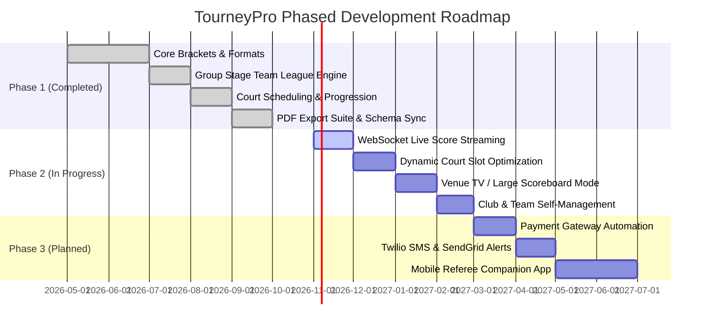

# TourneyPro — Phased Delivery Roadmap & Execution Plan (PLAN.md)

**Document Status:** Approved  
**Source of Truth:** Inherits from [`README.md`](file:///Users/rahilmehta24/VS_Code/Projects/TourneyPro/README.md), [`PRD.md`](file:///Users/rahilmehta24/VS_Code/Projects/TourneyPro/PRD.md), and [`ARCHITECTURE.md`](file:///Users/rahilmehta24/VS_Code/Projects/TourneyPro/ARCHITECTURE.md)  
**Current Milestone:** Phase 1 Completed / Phase 2 In Progress  
**Last Updated:** October 2026  

---

## 1. Roadmap Overview & Strategic Objectives

TourneyPro's product roadmap is structured into three iterative phases to balance immediate operational reliability with long-term real-time automation:

---

## 2. Phase 1: Core Lifecycle & Ecosystem (✅ COMPLETED)

Phase 1 established the stable operational foundation of TourneyPro, replacing legacy manual spreadsheets and paper draw sheets.

### 2.1 Completed Milestones & Capabilities
1. **Mathematical Tournament Formats:**
   * Single Elimination & Doubles Elimination with automatic power-of-2 ($2^k$) Bye distribution for top seeds.
   * Round Robin leagues with cumulative game point ranking and optional 1-click knockout phase transitions.
   * Group Stage Team Leagues featuring 3-rubber fixtures (Singles 1, Doubles, Singles 2), the $T=7$ summation rule, first-to-11 tie victories, and mid-match walkover remainder scoring.
   * Team draft wizards: Mode A (Manual Chit Draw with duplicate prevention) and Mode B (Auto-balanced Tier A-E draft).
2. **Order of Play & Court Logistics Engine:**
   * Multi-day tournament calendars with daily operating hours (`08:00` to `20:00`) and individual court rosters.
   * **Progression Locks:** Downstream matches are locked until upstream feeder matches conclude.
   * **Player Conflict Prevention:** Prevents players registered in multiple categories from being double-booked, enforcing a mandatory 30-minute rest buffer between matches.
3. **Smart Guest Registration & Player Registry:**
   * Guest athletes can register without creating user accounts; system auto-provisions global `Player` profiles.
   * Lifetime statistics tracking: Matches played, won, lost, win rates, and podium finishes.
4. **Vector PDF Export Suite:**
   * High-fidelity printable vector PDF downloads for Draws, Order of Play, and Participant Rosters via `xhtml2pdf` and `reportlab`.
5. **Quality Assurance & Deployment Automation:**
   * 72 automated unit and integration tests passing cleanly.
   * GitHub Actions CI quality gates and automated database schema synchronization (`scripts/sync_db_schema.py`) for Supabase PostgreSQL.

---

## 3. Phase 2: Enhanced Real-Time Tournament Operations (⚡ ACTIVE)

Phase 2 focuses on modernizing tournament venues with real-time score feeds and automated court slot assignment.

### 3.1 Work Packages

#### WP 2.1: Real-Time Score Updates via WebSockets
* **Objective:** Replace current 5-second HTTP polling (`/api/v1/live/<slug>/scores`) with instantaneous WebSocket push events.
* **Architecture:**
  * Integrate `Flask-SocketIO` with an event-driven broadcast channel per tournament room (`tournament_<slug>`).
  * When an organizer reports a score via the modal or API, emit a `score_update` event with payload `{ match_id, score1, score2, status, winner_id }`.
  * Public web client subscribes to the socket room; DOM nodes update with subtle flash animations without full page reloads.

#### WP 2.2: Dynamic Match Scheduling & Court Assignment
* **Objective:** Move from manual court assignment to automated constraint optimization.
* **Algorithm Requirements:**
  * Calculate round dependencies dynamically.
  * Auto-assign the next eligible match to the first court that becomes free.
  * Predict match end times dynamically based on sport averages and historical set counts.

#### WP 2.3: Venue TV & Scoreboard Display Mode
* **Objective:** Deliver a full-screen, high-contrast display mode optimized for venue projectors and clubhouse TV monitors.
* **Features:**
  * Carousel rotating between Live Matches, Court Schedule ("Now Playing" / "Up Next"), and Tournament Leaderboards.
  * Large-format typography legible from 20 meters away.

#### WP 2.4: Team & Club Portals
* **Objective:** Allow team managers to create club accounts, manage athlete rosters, and submit multi-player team entries directly.

---

## 4. Phase 3: Communication & Automated Payments (🗓️ PLANNED)

Phase 3 introduces automated participant notifications and self-service ticketing.

### 4.1 Work Packages

#### WP 3.1: Automated Payment Gateway Integration
* **Stripe & Razorpay Integration:**
  * Replace manual UPI transaction ID submissions with automated checkout sessions.
  * Implement webhook handlers for `checkout.session.completed` and `payment_intent.succeeded` to automatically transition registration status from `pending` to `approved`.
  * Automatic refund triggers if a category is cancelled or player is withdrawn before the draw.

#### WP 3.2: Automated Notification Engine (SMS & Email)
* **SMS Integration (Twilio):**
  * Immediate SMS alerts: *"Your draw is ready! You play [Opponent] at [Time] on [Court]."*
  * Urgent court dispatch notifications: *"Court 2 is ready! Please report for your match in 10 minutes."*
* **Email Integration (SendGrid):**
  * Registration receipts and confirmation tickets.
  * Printable PDF draw sheets attached to announcement emails.

#### WP 3.3: Native Mobile Companion App
* Dedicated mobile application for Android and iOS (React Native or Flutter) tailored specifically for court umpires to submit scores live court-side.

---

## 5. Risk Assessment & Mitigation Matrix

| Risk Event | Severity | Probability | Mitigation Strategy |
| :--- | :---: | :---: | :--- |
| **Connection Pooling Exhaustion on Supabase** | High | Low | Enforce `prepare_threshold: None` and `pool_pre_ping: True` in `config.py` to support PgBouncer transaction pooling. |
| **Tournament Delay Cascades (Inclement Weather)** | High | Medium | Implement bulk schedule delay actions (`Shift all remaining matches by +60 minutes`). |
| **Double-Booking on Manual Court Changes** | Medium | Medium | Automated validation warnings in `check_match_progression_allowed()` immediately flag overlapping matches. |
| **Vercel Serverless Cold Starts** | Low | Low | Cold-start bypass implemented in `app/__init__.py` (skips redundant schema queries on boot). |
