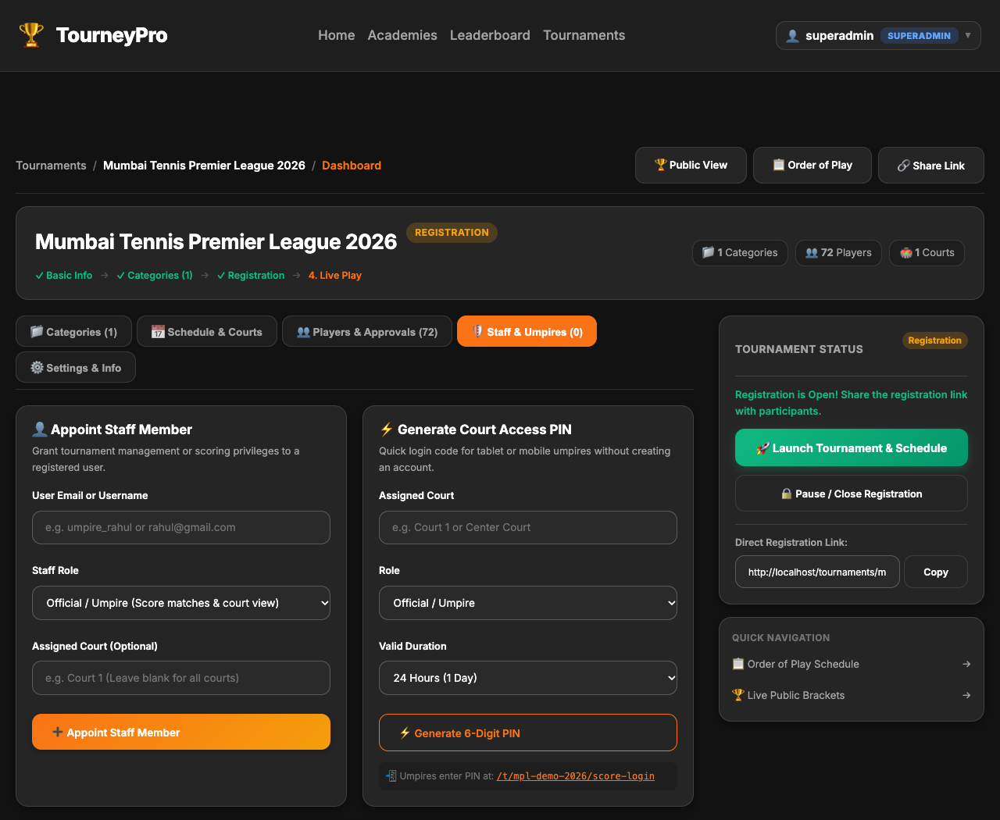
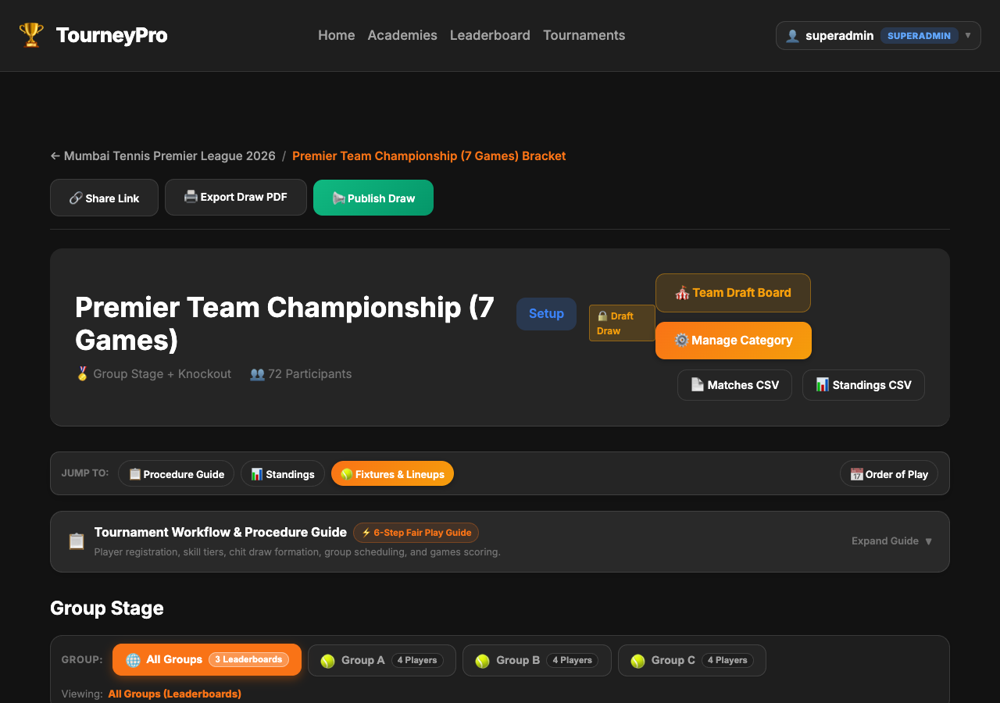
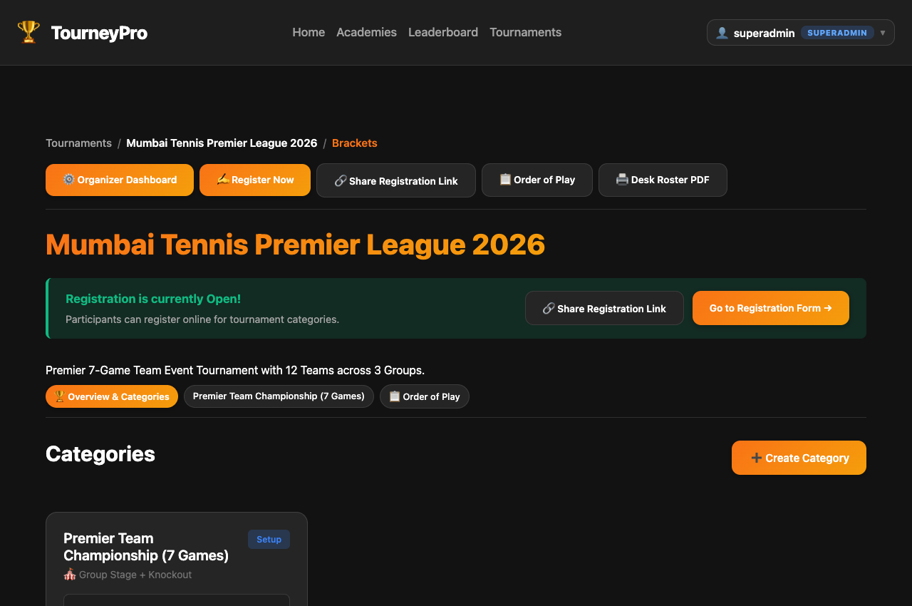
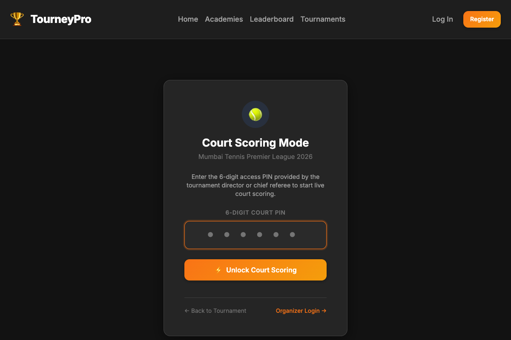
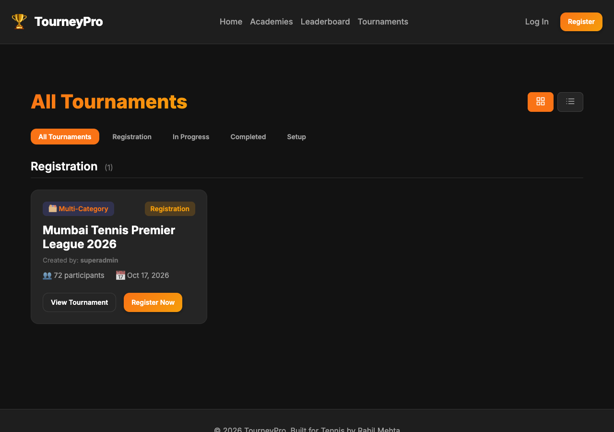

# 🏆 TourneyPro User Manual
### Simple Step-by-Step Guide for Tournament Directors, Umpires, Captains & Players

Welcome to **TourneyPro**! This user guide walks you through every action you can perform on the website. No technical setup is required—just open your browser on your computer, tablet, or mobile phone.

---

## 📋 Table of Contents
1. [User Roles Overview](#1-user-roles-overview)
2. [For Tournament Organizers & Directors](#2-for-tournament-organizers--directors)
   - [2.1 Appointing Tournament Staff & Umpires](#21-appointing-tournament-staff--umpires)
   - [2.2 Creating a 6-Digit PIN for Court Umpires](#22-creating-a-6-digit-pin-for-court-umpires)
   - [2.3 Publishing the Draw (Draft vs. Public)](#23-publishing-the-draw-draft-vs-public)
   - [2.4 Printing the Check-in Desk Roster PDF](#24-printing-the-check-in-desk-roster-pdf)
   - [2.5 Downloading Matches and Standings Sheets](#25-downloading-matches-and-standings-sheets)
3. [For Court Scorers & Chair Umpires](#3-for-court-scorers--chair-umpires)
   - [3.1 Logging in with a 6-Digit Court PIN](#31-logging-in-with-a-6-digit-court-pin)
   - [3.2 Entering Live Tennis Match Scores](#32-entering-live-tennis-match-scores)
   - [3.3 Fair Play Rule: Competitors Cannot Score Their Own Matches](#33-fair-play-rule-competitors-cannot-score-their-own-matches)
4. [For Team League Captains](#4-for-team-league-captains)
   - [4.1 Submitting Your Team Lineup](#41-submitting-your-team-lineup)
   - [4.2 The 15-Minute Deadline Rule](#42-the-15-minute-deadline-rule)
5. [For Players, Parents & Spectators](#5-for-players-parents--spectators)
   - [5.1 Registering for Tournaments](#51-registering-for-tournaments)
   - [5.2 Checking Match Times & Court Allocations](#52-checking-match-times--court-allocations)
   - [5.3 Viewing Live Scores & Brackets](#53-viewing-live-scores--brackets)
6. [Frequently Asked Questions (FAQ)](#6-frequently-asked-questions-faq)

---

## 1. User Roles Overview

| Role | What They Can Do |
| :--- | :--- |
| **🏆 Tournament Director (Organizer)** | Creates tournaments, manages divisions, appoints staff, generates umpire court PINs, toggles public draw publication, and prints the Desk Check-in Roster. |
| **👔 Tournament Staff (Manager / Official)** | Helps manage daily court schedules, handles delays, adjudicates walkovers, and oversees match play. |
| **⏱️ Court Scorer / Chair Umpire** | Scores matches live on court using a laptop, tablet, or phone (via normal login or instant 6-digit court PIN). |
| **🧢 Team Captain** | Submits player pairings for their team in league matches before the 15-minute pre-match deadline. |
| **🎾 Player / Athlete / Parent** | Registers for events, tracks personal match schedules on Order of Play, and views personal win/loss records. |
| **🌐 Spectator / Fan** | Browses public tournaments, tracks live scores ball-by-ball, and downloads official bracket PDFs. |

---

## 2. For Tournament Organizers & Directors

### 2.1 Appointing Tournament Staff & Umpires
As the tournament director, you can delegate scoring and court management to other registered users without sharing your account password.

#### Steps to Appoint Staff:
1. Log in and open your tournament dashboard (`/t/<slug>/manage`).
2. Click on the **🛡️ Staff & Umpires** tab.
3. Under **👤 Appoint Staff Member**:
   - **User Email or Username**: Type the username or email of the person you want to appoint.
   - **Staff Role**: Select `Manager` (schedules & scores), `Official / Referee` (rules & scoring), or `Scorer` (live score entry only).
   - **Assigned Court (Optional)**: E.g., `Court 1` or leave blank for all courts.
4. Click **➕ Appoint Staff Member**. Privileges are active immediately!

---

### 2.2 Creating a 6-Digit PIN for Court Umpires
If you have volunteer umpires, court attendants, or referees who do not have an account on TourneyPro, you can issue them a temporary 6-digit PIN.

#### Steps to Generate an Umpire PIN:
1. In the **🛡️ Staff & Umpires** tab, find the **⚡ Generate Court Access PIN** card.
2. Enter the **Assigned Court** (e.g., `Court 2` or `Center Court`).
3. Select the role (**Scorer**) and duration (e.g., **24 Hours (1 Day)**).
4. Click **⚡ Generate 6-Digit PIN**.
5. Give this 6-digit PIN to the umpire with the login link: `http://<your-domain>/t/<slug>/score-login`.

---

### 2.3 Publishing the Draw (Draft vs. Public)
While you are seeding players or balancing draws, keep brackets in **Draft** mode so players and spectators do not download incomplete draws.

#### How it Works:
- While in **Draft**, a `🔒 Draft Draw` badge is displayed. Public visitors cannot download the Draw PDF.
- Organizers and admins can preview the PDF draft at any time.
- To publish the draw:
  1. Open the Category view (`/t/<slug>/categories/<id>`).
  2. Click the green **📢 Publish Draw** button at the top header.
  3. The badge updates to `✅ Published`. The public can now immediately download the official Draw PDF!
  4. If changes are needed, click **🔒 Unpublish (Draft)** to take it down temporarily.

---

### 2.4 Printing the Check-in Desk Roster PDF
On tournament day, the registration desk needs a physical roster of all players, contact numbers, and payment details.

#### Steps to Download the Desk Roster:
1. Open the Tournament Hub (`/t/<slug>?view=bracket`).
2. Click the **🖨️ Desk Roster PDF** button in the top action bar.
3. A clean, formatted check-in sheet will open, ready to print for your physical registration desk.
4. *Privacy Notice:* This button is strictly visible only to tournament directors and platform admins.

---

### 2.5 Downloading Matches and Standings Sheets
On each category page, organizers have quick access to:
- **📄 Matches CSV**: Complete list of matches, courts, and scores for spreadsheets.
- **📊 Standings CSV**: Team points, set differentials, and qualification rankings.

---

## 3. For Court Scorers & Chair Umpires

### 3.1 Logging in with a 6-Digit Court PIN
Umpires do **not** need to create an account or remember a password to score matches.

#### Steps for Umpires:
1. Open the browser on your phone or tablet and visit: `/t/<slug>/score-login`.
2. Enter the **6-digit Court PIN** (e.g., `849201`).
3. Tap **⚡ Unlock Court Scoring**. You are now logged into Court Scoring Mode!
4. When your shift ends, tap **Exit Court Scoring** to log out.

---

### 3.2 Entering Live Tennis Match Scores
1. In the Category or Order of Play view, tap on your match.
2. Tap **Report Score**.
3. Type the tennis score using standard formatting:
   - **Regular Sets**: `6-4, 6-3`
   - **Tiebreak Set**: `7-6(4), 6-4` *(loser's tiebreak points inside parentheses)*
   - **Super Tiebreak**: `6-4, 4-6, [10-7]`
4. Select the **Match Winner** and tap **Submit Result**.
5. *Simultaneous Score Notice:* If another official updated the score while your screen was open, the system will notify you. Simply refresh the page to view the latest score.

---

### 3.3 Fair Play Rule: Competitors Cannot Score Their Own Matches
To ensure sportsmanship:
- If you are a registered player in a match, the system automatically blocks you from recording or altering scores for that match.
- An independent umpire, official, or the director must report your match.

---

## 4. For Team League Captains

### 4.1 Submitting Your Team Lineup
In team championships, captains nominate which squad players will play in each individual match (rubber).

#### Steps to Submit Lineups:
1. Log in with your player account.
2. Open your team category page (`/t/<slug>/categories/<id>`).
3. Find your upcoming tie and click **Allot Lineup**.
4. Select Player 1 (and Player 2 for doubles) for each rubber. *(Opponent fields are protected and cannot be edited by your team)*.
5. Click **Save Lineups**.

---

### 4.2 The 15-Minute Deadline Rule
- **Important:** Lineups automatically lock **15 minutes before the scheduled match time**.
- Submit nominations early! If an emergency substitution is needed within 15 minutes, please contact the Chief Referee.

---

## 5. For Players, Parents & Spectators

### 5.1 For Players & Parents
- **Online Registration:** Tap **✍️ Register Now** on any open tournament to enroll in singles or doubles divisions.
- **Find Match Times:** Tap **📋 Order of Play** at the top of the tournament page to view your court number, opponent, and estimated start time.
- **Player Dashboard:** Visit `/player/profile` to manage personal details and track your tournament history.

### 5.2 For Spectators & Fans
- **Live Scoreboards:** Follow active matches in real time as chair umpires input points from the court.
- **Official PDFs:** Download daily **Order of Play PDFs** and official **Draw PDFs** (once published by the director).

---

## 6. Frequently Asked Questions (FAQ)

#### Q: Why does the Draw PDF say it's unpublished?
**A:** The organizer is finalizing the draw. Once published, the download button will activate automatically.

#### Q: Can an umpire use their smartphone on court?
**A:** Yes! The `/score-login` interface is designed specifically for mobile touchscreens and tablets.

#### Q: What happens if a player gets injured during a match?
**A:** The umpire can select `Retired` in the score submission modal, and the opponent advances automatically.

#### Q: Can a player score their own match?
**A:** No. The system prevents competitors from submitting results for their own matches to maintain complete integrity.

---
*TourneyPro — Built for Tennis Tournament Directors, Umpires & Players.*
